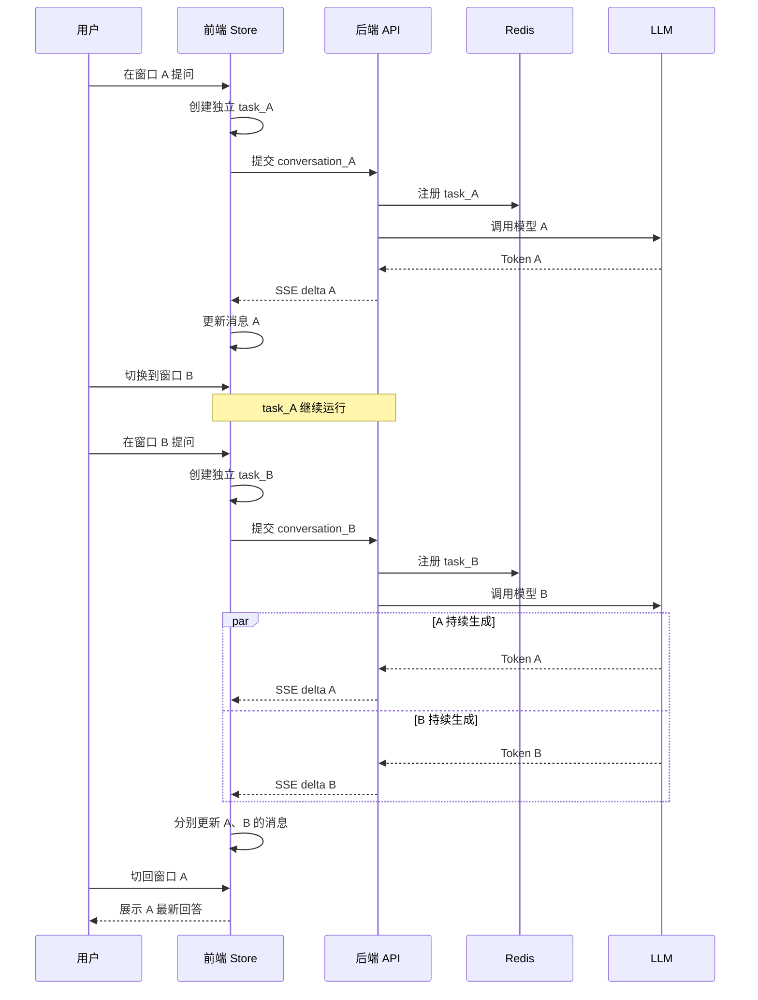

# 【AI】多窗口流式问答设计（前后端）

## 问题

在 AI 问答页面中，如果使用 SSE 或 WebSocket 实现大模型流式输出，同时支持多个聊天窗口（类似 ChatGPT 左侧会话列表），核心问题是：

**每个聊天窗口必须拥有独立的会话上下文、独立的流式请求、独立的消息状态和独立的取消控制。**

例如：
1. 用户在窗口 A 提问，AI 正在流式生成回答。
2. 用户切换到窗口 B，继续发起新的提问。
3. 窗口 A 的回答仍然可以在后台继续生成。
4. 用户再次切回窗口 A，可以看到已经生成的内容，并继续接收后续内容。
5. 即使窗口 A 和窗口 B 同时生成，也不能出现消息串线、上下文混乱、状态覆盖等问题。

这里最重要的设计原则是：

**将聊天会话（Conversation）、消息（Message）和流式任务（Stream Task）进行解耦，不能将流式请求绑定到当前页面或当前选中的聊天窗口。**

下面从前端、后端、流式通信、状态管理和异常处理五个方面设计一套可落地的方案。

---

# 一、整体架构设计

技术栈：
- 前端：Vue 3 + Pinia
- 通信：SSE。
- 后端：FastAPI
- 消息存储：PostgreSQL
- 缓存与任务状态：Redis
- 消息队列：Kafka


<box border radius="lg" padding={3} gap={3}>
  <title size="lg">多聊天窗口流式问答架构</title>
  <box background="rgba(59,130,246,0.08)" radius="md" padding={3} align="center" gap={1}>
    **前端 UI 层**
    <text color="secondary" size="xs">聊天窗口 A ｜ 聊天窗口 B ｜ 聊天窗口 C</text>
  </box>
  <box align="center">
    <icon name="arrow-down" color="secondary" size="lg"/>
  </box>
  <box border radius="md" padding={3} gap={2}>
    **前端状态管理层（Pinia / Zustand）**
    <grid columns={2} gap={2}>
      <grid-item background="rgba(59,130,246,0.07)" radius="md" padding={2}>
        <text weight="medium" size="sm">Conversation A</text>
        <text color="secondary" size="xs">消息列表、任务ID、流式状态</text>
      </grid-item>
      <grid-item background="rgba(59,130,246,0.07)" radius="md" padding={2}>
        <text weight="medium" size="sm">Conversation B</text>
        <text color="secondary" size="xs">消息列表、任务ID、流式状态</text>
      </grid-item>
    </grid>
    <text color="secondary" size="xs" textAlign="center">独立状态、独立 AbortController、独立事件处理</text>
  </box>
  <box align="center">
    <icon name="arrow-down" color="secondary" size="lg"/>
  </box>
  <box background="rgba(16,185,129,0.08)" radius="md" padding={3} align="center">
    **HTTP / SSE 通信层**
    <text size="xs" color="secondary">conversation_id + task_id + message_id</text>
  </box>
  <box align="center">
    <icon name="arrow-down" color="secondary" size="lg"/>
  </box>
  <box border radius="md" padding={3} gap={2}>
    **后端业务服务层**
    <grid columns={2} gap={2}>
      <grid-item background="rgba(16,185,129,0.07)" radius="md" padding={2}>
        **会话管理服务**
        <text size="xs" color="secondary">会话创建、查询、权限</text>
      </grid-item>
      <grid-item background="rgba(16,185,129,0.07)" radius="md" padding={2}>
        **流式任务管理服务**
        <text size="xs" color="secondary">任务创建、取消、状态</text>
      </grid-item>
      <grid-item background="rgba(16,185,129,0.07)" radius="md" padding={2}>
        **上下文管理服务**
        <text size="xs" color="secondary">历史消息、Prompt 构建</text>
      </grid-item>
      <grid-item background="rgba(16,185,129,0.07)" radius="md" padding={2}>
        **LLM 推理服务**
        <text size="xs" color="secondary">模型调用、Token 输出</text>
      </grid-item>
    </grid>
  </box>
  <box align="center">
    <icon name="arrow-down" color="secondary" size="lg"/>
  </box>
  <grid columns={2} gap={2}>
    <grid-item border radius="md" padding={2}>
      <icon name="database" size="lg"/>
      **MySQL**
      <text color="secondary" size="xs">会话、消息、任务记录</text>
    </grid-item>
    <grid-item border radius="md" padding={2}>
      <icon name="database" size="lg"/>
      **Redis**
      <text color="secondary" size="xs">任务状态、取消标记、事件缓存</text>
    </grid-item>
  </grid>
</box>

整体可以理解为：前端管理多个独立会话，后端管理多个独立生成任务，二者通过唯一标识建立关联。

---

# 二、前端设计：每个聊天窗口独立管理

## 2.1 数据结构设计

不是只维护一个全局的 `messages` 数组，而应该按照 `conversationId` 维护消息列表。

数据结构：

```typescript
interface Conversation {
  id: string;
  title: string;
  messages: Message[];
  activeTaskId?: string;
  status: 'idle' | 'streaming' | 'error';
  updatedAt: number;
}

interface Message {
  id: string;
  conversationId: string;
  role: 'user' | 'assistant';
  content: string;
  status: 'pending' | 'streaming' | 'completed' | 'error';
  createdAt: number;
}

interface StreamTask {
  taskId: string;
  conversationId: string;
  assistantMessageId: string;
  controller: AbortController;
  status: 'running' | 'completed' | 'cancelled' | 'error';
}
```

核心是三个 ID：

| ID | 作用 |
|---|---|
| conversationId | 标识聊天会话 |
| messageId | 标识具体消息 |
| taskId | 标识一次大模型生成任务 |

三者不能混用。

例如：

```text
Conversation A
  ├── Message 1（用户问题）
  ├── Message 2（AI回答）
  └── Task A1

Conversation B
  ├── Message 3（用户问题）
  ├── Message 4（AI回答）
  └── Task B1
```

即使两个窗口同时生成，后端也能够准确识别每个任务属于哪个会话。

## 2.2 前端状态管理

Vue 3 + Pinia：

```typescript
export const useChatStore = defineStore('chat', {
  state: () => ({
    conversations: {} as Record<string, Conversation>,
    activeConversationId: '',
    tasks: {} as Record<string, StreamTask>
  }),

  getters: {
    currentConversation(state) {
      return state.conversations[state.activeConversationId];
    }
  },

  actions: {
    switchConversation(id: string) {
      this.activeConversationId = id;
    },

    updateMessage(
      conversationId: string,
      messageId: string,
      delta: string
    ) {
      const conversation = this.conversations[conversationId];
      if (!conversation) return;

      const message = conversation.messages.find(
        item => item.id === messageId
      );

      if (message) {
        message.content += delta;
      }
    }
  }
});
```

**关键点**：`updateMessage()` 必须通过 `conversationId + messageId` 定位消息，而不是直接修改当前页面显示的消息。否则，当用户切换窗口时，可能会将 A 窗口的 Token 错误追加到 B 窗口。

## 2.3 流式请求独立管理

解决窗口切换互不影响的核心。

### 常见错误实现：全局只有一个控制器
```typescript
let controller = new AbortController();
```

如果 A 窗口发起请求，B 窗口再发起请求，后者可能覆盖前者的控制器，导致无法正确管理 A 的请求。


### 正确做法：
**每次生成请求创建独立的 AbortController，并使用 taskId 保存。**

```typescript
async function sendMessage(
  conversationId: string,
  content: string
) {
  const store = useChatStore();

  const userMessageId = crypto.randomUUID();
  const assistantMessageId = crypto.randomUUID();
  const taskId = crypto.randomUUID();

  const conversation = store.conversations[conversationId];

  // 1. 添加用户消息
  conversation.messages.push({
    id: userMessageId,
    conversationId,
    role: 'user',
    content,
    status: 'completed',
    createdAt: Date.now()
  });

  // 2. 添加 AI 占位消息
  conversation.messages.push({
    id: assistantMessageId,
    conversationId,
    role: 'assistant',
    content: '',
    status: 'streaming',
    createdAt: Date.now()
  });

  // 3. 创建独立控制器
  const controller = new AbortController();

  store.tasks[taskId] = {
    taskId,
    conversationId,
    assistantMessageId,
    controller,
    status: 'running'
  };

  conversation.activeTaskId = taskId;
  conversation.status = 'streaming';

  try {
    const response = await fetch('/api/chat/stream', {
      method: 'POST',
      headers: {
        'Content-Type': 'application/json'
      },
      body: JSON.stringify({
        conversationId,
        taskId,
        userMessageId,
        assistantMessageId,
        content
      }),
      signal: controller.signal
    });

    if (!response.ok || !response.body) {
      throw new Error('流式请求失败');
    }

    const reader = response.body.getReader();
    const decoder = new TextDecoder();

    let buffer = '';

    while (true) {
      const { done, value } = await reader.read();
      if (done) break;

      buffer += decoder.decode(value, { stream: true });

      // 生产环境建议使用完整的 SSE 解析器，
      // 处理跨 chunk、跨行和多事件情况。
      const events = buffer.split('\n\n');
      buffer = events.pop() ?? '';

      for (const event of events) {
        const dataLine = event
          .split('\n')
          .find(line => line.startsWith('data:'));

        if (!dataLine) continue;

        const data = JSON.parse(
          dataLine.slice(5).trim()
        );

        // 4. 根据消息 ID 定位更新对象
        if (data.type === 'delta') {
          store.updateMessage(
            conversationId,
            assistantMessageId,
            data.content
          );
        }

        if (data.type === 'done') {
          store.tasks[taskId].status = 'completed';
        }
      }
    }

  } catch (error: any) {
    if (error.name === 'AbortError') {
      console.log('任务已取消');
    } else {
      console.error(error);
      store.tasks[taskId].status = 'error';
    }
  } finally {
    const task = store.tasks[taskId];

    if (task) {
      const current = store.conversations[conversationId];

      if (current?.activeTaskId === taskId) {
        current.activeTaskId = undefined;
        current.status = 'idle';
      }
    }
  }
}
```

**注意点**：
- 1. `AbortController` 必须属于单次任务，不能多个窗口共享。
- 2. SSE 回调必须根据固定的 `conversationId` 和 `messageId` 更新数据。
- 3. 切换窗口只修改 `activeConversationId`，不应该取消原来的流式请求。
- 4. 流式请求管理逻辑应该放在 Pinia Store 或独立的 ChatService 中，而不是聊天组件内部。
- 5. 生产环境需要处理 SSE 的 `id`、`event`、`data`、多行数据和不完整数据块，不能简单依赖 `split('\n\n')`。

## 2.4 切换窗口时应该做什么？

假设当前有三个窗口：

<box border radius="lg" padding={3} gap={3}>
  <row align="center" justify="between">
    **聊天会话**
    <badge color="success">3 个会话</badge>
  </row>
  {#each [{id:"A",name:"窗口 A",status:"正在生成",content:"正在分析用户问题……",color:"success"},{id:"B",name:"窗口 B",status:"正在生成",content:"正在检索知识库……",color:"success"},{id:"C",name:"窗口 C",status:"已完成",content:"回答已生成",color:"secondary"}] as item}
    <row align="center" gap={2}>
      <box background="surface-secondary" radius="md" size="40px" align="center" justify="center">
        **{item.id}**
      </box>
      <box flex="1" gap={1}>
        **{item.name}**
        <text size="xs" color="secondary">{item.content}</text>
      </box>
      <badge color={item.color}>{item.status}</badge>
    </row>
  {/each}
  <divider color="subtle"/>
  <text color="secondary" size="xs">切换窗口 B → A → C，不会取消 A、B 的生成任务。</text>
</box>

切换窗口时只需要：

```typescript
function switchChat(conversationId: string) {
  chatStore.activeConversationId = conversationId;
}
```

不需要：
- 重新发起大模型请求。
- 重新创建 AbortController。
- 取消之前的请求。
- 清空其他窗口的消息。
- 将其他窗口的消息复制到当前窗口。

**注意：不要在 Vue 组件的 onUnmounted 或 React 组件的 cleanup 中，无条件取消流式请求。**

因为窗口切换可能导致组件卸载，而请求应该继续在 Store 或 ChatService 中运行。

---

# 三、后端设计：每个会话独立维护上下文

前端隔离只是第一步，后端也必须隔离。

如果后端只维护一个全局对话历史，例如：

```python
history = []
```

那么多个用户、多个窗口的上下文就可能相互污染。

应该以 `conversation_id` 作为会话隔离的基本单位，以 `task_id` 作为生成任务的管理单位。

## 3.1 数据库设计

三张核心表。

### 1. 会话表 conversation

| 字段 | 说明 |
|---|---|
| id | 会话 ID |
| user_id | 所属用户 |
| title | 会话标题 |
| status | 会话状态 |
| created_at | 创建时间 |
| updated_at | 更新时间 |

### 2. 消息表 message

| 字段 | 说明 |
|---|---|
| id | 消息 ID |
| conversation_id | 所属会话 |
| user_id | 用户 ID |
| role | user / assistant |
| content | 消息内容 |
| status | 消息状态 |
| sequence | 消息顺序 |
| created_at | 创建时间 |

### 3. 任务表 generation_task

| 字段 | 说明 |
|---|---|
| id | 任务 ID |
| conversation_id | 所属会话 |
| user_id | 用户 ID |
| assistant_message_id | AI 消息 ID |
| status | running/completed/cancelled/error |
| cancel_requested | 是否请求取消 |
| started_at | 开始时间 |
| finished_at | 结束时间 |

### 数据库关系：

```text
User
 ├── Conversation A
 │    ├── Message 1
 │    ├── Message 2
 │    └── Task A1
 │
 └── Conversation B
      ├── Message 3
      ├── Message 4
      └── Task B1
```

需要建立以下索引：

```sql
CREATE INDEX idx_conversation_user
ON conversation(user_id);

CREATE INDEX idx_message_conversation_sequence
ON message(conversation_id, sequence);

CREATE INDEX idx_task_conversation_status
ON generation_task(conversation_id, status);
```

## 3.2 后端 API 设计

建议将会话管理和流式任务管理拆开。

| API | 方法 | 功能 |
|---|---|---|
| `/api/conversations` | POST | 创建会话 |
| `/api/conversations` | GET | 获取会话列表 |
| `/api/conversations/{id}` | GET | 获取会话详情 |
| `/api/conversations/{id}/messages` | GET | 获取历史消息 |
| `/api/chat/stream` | POST | 创建流式生成任务 |
| `/api/tasks/{id}` | GET | 获取任务状态 |
| `/api/tasks/{id}/cancel` | POST | 取消生成任务 |
| `/api/tasks/{id}/events` | GET | 重新订阅流式事件 |

其中，`/api/chat/stream` 接收：

```json
{
  "conversationId": "conv_001",
  "taskId": "task_001",
  "userMessageId": "msg_001",
  "assistantMessageId": "msg_002",
  "content": "请介绍一下RAG架构"
}
```

后端不能完全信任前端传入的 ID，需要校验当前登录用户是否有权访问对应会话，并校验消息和任务 ID 的归属关系。

## 3.3 后端流式生成逻辑

核心逻辑：

```python
from fastapi import FastAPI
from fastapi.responses import StreamingResponse
from pydantic import BaseModel
import asyncio
import json

app = FastAPI()

class ChatRequest(BaseModel):
    conversationId: str
    taskId: str
    userMessageId: str
    assistantMessageId: str
    content: str

# 演示用：生产环境使用 Redis / 数据库
task_registry = {}

async def mock_llm_stream(prompt: str):
    for token in ["RAG", "是一种", "检索增强生成", "技术。"]:
        await asyncio.sleep(0.5)
        yield token

@app.post("/api/chat/stream")
async def chat_stream(request: ChatRequest):

    conversation_id = request.conversationId
    task_id = request.taskId

    # 1. 获取当前会话的独立历史
    history = await get_history(conversation_id)

    # 2. 保存用户消息
    await save_user_message(
        conversation_id,
        request.userMessageId,
        request.content
    )

    # 3. 注册独立任务
    stop_event = asyncio.Event()
    task_registry[task_id] = stop_event

    async def generate():

        answer = ""

        try:
            # 4. 独立构建当前会话 Prompt
            prompt = build_prompt(history, request.content)

            async for token in mock_llm_stream(prompt):

                if stop_event.is_set():
                    break

                answer += token

                event = {
                    "type": "delta",
                    "taskId": task_id,
                    "conversationId": conversation_id,
                    "messageId": request.assistantMessageId,
                    "content": token
                }

                yield f"data: {json.dumps(event, ensure_ascii=False)}\n\n"

            if stop_event.is_set():
                status = "cancelled"
            else:
                status = "completed"

            # 5. 保存最终消息
            await save_assistant_message(
                conversation_id,
                request.assistantMessageId,
                answer,
                status
            )

            yield f"data: {json.dumps({'type': 'done', 'taskId': task_id, 'status': status})}\n\n"

        except Exception as e:
            await mark_task_error(task_id, str(e))

            event = {
                "type": "error",
                "taskId": task_id,
                "message": str(e)
            }

            yield f"data: {json.dumps(event)}\n\n"

        finally:
            task_registry.pop(task_id, None)

    return StreamingResponse(
        generate(),
        media_type="text/event-stream",
        headers={
            "Cache-Control": "no-cache",
            "X-Accel-Buffering": "no"
        }
    )
```

这里的 `get_history`、`save_user_message`、`save_assistant_message`、`mark_task_error`、`build_prompt` 是需要接入实际数据库和业务服务的函数。

---

# 四、流式任务与窗口切换的关系

这里需要区分三个不同的操作。

| 用户操作 | 前端行为 | 后端行为 |
|---|---|---|
| 切换聊天窗口 | 只切换显示内容 | 不做任何处理 |
| 关闭聊天窗口组件 | 不取消任务 | 继续生成 |
| 点击停止生成 | 取消对应 taskId | 停止对应模型任务 |
| 刷新浏览器 | 恢复会话和任务状态 | 查询任务状态、恢复事件 |
| 删除会话 | 清理当前会话状态 | 取消相关任务并删除或归档数据 |

## 4.1 如何实现独立取消？

不能使用一个全局的停止标记。

错误实现：

```python
stop_generation = False
```

正确实现：

```python
task_registry = {
    "task_001": asyncio.Event(),
    "task_002": asyncio.Event()
}
```

取消指定任务：

```python
@app.post("/api/tasks/{task_id}/cancel")
async def cancel_task(task_id: str):

    stop_event = task_registry.get(task_id)

    if stop_event:
        stop_event.set()

    return {
        "taskId": task_id,
        "status": "cancel_requested"
    }
```

实际生产环境还需要：
- 校验任务所属用户。
- 更新数据库中的任务状态。
- 通知实际执行模型推理的 Worker。
- 取消模型 SDK 的生成请求，而不只是停止向前端发送 Token。
- 处理任务已经完成、已经取消等幂等情况。

前端停止某个窗口的任务：

```typescript
function stopGeneration(taskId: string) {
  const store = useChatStore();
  const task = store.tasks[taskId];

  if (!task) return;

  // 立即停止当前客户端的数据接收
  task.controller.abort();

  // 同时通知后端停止模型任务
  fetch(`/api/tasks/${taskId}/cancel`, {
    method: 'POST'
  });
}
```

注意：`abort()` 只能保证客户端停止接收数据，不代表后端模型推理一定停止。因此需要同时发送取消指令。

## 4.2 用户切换窗口后，如何保证流式内容不丢失？

假设：

```text
16:00:00  窗口 A 开始生成
16:00:02  窗口 A 已生成 100 Token
16:00:03  用户切换到窗口 B
16:00:05  窗口 A 已生成 200 Token
16:00:08  用户切回窗口 A
```

由于 A 的请求仍然在后台执行，Store 会持续接收 Token 并更新 A 的消息。

因此用户切回 A 时，可以直接看到最新的 200 Token 或更多内容。

但还有一个容易忽略的问题：浏览器刷新、网络断开、电脑休眠等情况可能导致 SSE 连接中断。

建议增加**事件持久化与断点续传机制**：

```text
LLM Token 输出
      |
      v
Stream Event
      |
      v
Redis Stream / 数据库
      |
      +------> SSE 推送给前端
      |
      +------> 持久化最终消息
```

每个事件增加递增序号：

```json
{
  "eventId": 105,
  "taskId": "task_001",
  "conversationId": "conv_001",
  "messageId": "msg_002",
  "type": "delta",
  "content": "检索增强生成"
}
```

前端记录最后收到的 `eventId`。

重连时：

```http
GET /api/tasks/task_001/events?after=105
```

后端从 105 之后继续推送事件。

如果使用原生 SSE 的 `EventSource`，还可以使用 `Last-Event-ID`；但你的场景使用 POST 提交问题时，推荐继续使用 `fetch + ReadableStream`，通过查询参数或请求头实现断点续传。

**注意：事件重放需要去重，前端不能重复追加已经接收过的 Token。** 如果事件记录已过期，还应支持通过消息快照恢复完整内容。

---

# 五、生产环境进一步优化

如果只是一个用户、一个后端实例，前面这套设计基本可以满足需求。

但如果要构建真正的企业级 AI 问答系统，我建议再考虑以下几个问题。

## 5.1 多实例部署时的任务管理

假设后端有三个实例：

<box border radius="lg" padding={3} gap={2}>
  <box background="rgba(59,130,246,0.08)" radius="md" padding={2} align="center">
    **API Gateway / 负载均衡**
  </box>
  <grid columns={3} gap={2}>
    <grid-item border radius="md" padding={2} align="center">
      **服务 A**
      <text color="secondary" size="xs">Task 001</text>
    </grid-item>
    <grid-item border radius="md" padding={2} align="center">
      **服务 B**
      <text color="secondary" size="xs">Task 002</text>
    </grid-item>
    <grid-item border radius="md" padding={2} align="center">
      **服务 C**
      <text color="secondary" size="xs">Task 003</text>
    </grid-item>
  </grid>
  <box align="center">
    <icon name="arrow-down" color="secondary"/>
  </box>
  <box background="rgba(16,185,129,0.08)" radius="md" padding={3} align="center">
    **Redis / 消息队列**
    <text color="secondary" size="xs">任务状态、事件流、取消信号、任务路由</text>
  </box>
  <box align="center">
    <icon name="arrow-down" color="secondary"/>
  </box>
  <box border radius="md" padding={2} align="center">
    **LLM Worker 集群**
    <text color="secondary" size="xs">独立执行不同的推理任务</text>
  </box>
</box>

不能再依赖 Python 的全局 `task_registry`，因为任务可能由服务 A 创建，却由服务 B 接收到取消请求。

推荐：

- Redis：存储任务状态、任务与 Worker 的映射。
- Redis Pub/Sub：跨实例通知取消信号。
- Redis Streams：保存可重放的流式事件。
- Kafka：在任务规模较大、需要可靠异步处理和削峰时使用。

其中 Redis Pub/Sub 不保证消息持久化，取消通知如果要求可靠，需要配合任务状态轮询、Redis Streams 或其他可靠通知机制。

## 5.2 同一个窗口是否允许同时生成多个回答？

建议区分两种情况：

| 场景 | 推荐策略 |
|---|---|
| 不同会话同时生成 | 允许 |
| 同一会话同时生成 | 默认禁止 |
| 同一会话取消旧任务后重新生成 | 允许 |
| 不同用户同时生成 | 允许，受资源配额限制 |

为什么同一个会话建议默认禁止？

因为两个问题可能同时读取相同的历史上下文，最后生成结果的顺序不确定，容易造成上下文顺序混乱。

如果确实需要支持同一会话并发生成，则必须引入消息版本、上下文快照和明确的提交顺序。

通过`conversation_id + generation_lock`实现同一会话的生成互斥。

也可以使用数据库乐观锁或 Redis 分布式锁，但必须设置锁超时、续租和任务完成后的释放机制，防止死锁。

## 5.3 前端性能优化

如果多个窗口同时生成，Token 更新频率可能非常高。

不建议每收到一个 Token 就触发整个聊天页面重新渲染。

推荐：
- 1. 按 conversationId 分别管理消息状态。
- 2. 按 messageId 更新对应消息。
- 3. 对 UI 更新进行 30～60ms 的批量刷新。
- 4. 对长消息使用虚拟列表。
- 5. 历史消息分页加载。
- 6. 已完成的会话不再参与流式更新。
- 7. 对 Markdown 渲染进行增量优化，避免每个 Token 都完整解析整个文档。

特别是包含代码块、表格、数学公式的 AI 回答，Markdown 全量渲染可能成为性能瓶颈。

---

# 六、完整流程


