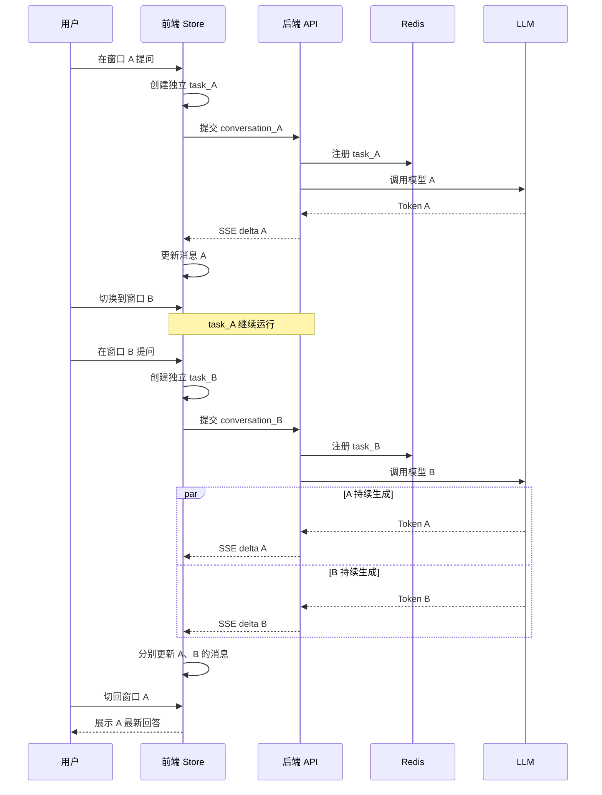

# 【AI】多窗口流式问答设计（前后端）

## 问题

在 AI 问答页面中，如果使用 SSE 或 WebSocket 实现大模型流式输出，同时支持多个聊天窗口（类似 ChatGPT 左侧会话列表），核心问题是：

**每个聊天窗口必须拥有独立的会话上下文、独立的流式请求、独立的消息状态和独立的取消控制。**

例如：
1. 用户在窗口 A 提问，AI 正在流式生成回答。
2. 用户切换到窗口 B，继续发起新的提问。
3. 窗口 A 的回答仍然可以在后台继续生成。
4. 用户再次切回窗口 A，可以看到已经生成的内容，并继续接收后续内容。
5. 即使窗口 A 和窗口 B 同时生成，也不能出现消息串线、上下文混乱、状态覆盖等问题。

这里最重要的设计原则是：

**将聊天会话（Conversation）、消息（Message）和流式任务（Stream Task）进行解耦，不能将流式请求绑定到当前页面或当前选中的聊天窗口。**

下面从前端、后端、流式通信、状态管理和异常处理五个方面设计一套可落地的方案。

---

# 一、整体架构设计

技术栈：
- 前端：Vue 3 + Pinia
- 通信：SSE。
- 后端：FastAPI
- 消息存储：PostgreSQL
- 缓存与任务状态：Redis
- 消息队列：Kafka


![]()

整体可以理解为：前端管理多个独立会话，后端管理多个独立生成任务，二者通过唯一标识建立关联。

---

# 二、前端设计：每个聊天窗口独立管理

## 2.1 数据结构设计

不是只维护一个全局的 `messages` 数组，而应该按照 `conversationId` 维护消息列表。

数据结构：

```typescript
interface Conversation {
  id: string;
  title: string;
  messages: Message[];
  activeTaskId?: string;
  status: 'idle' | 'streaming' | 'error';
  updatedAt: number;
}

interface Message {
  id: string;
  conversationId: string;
  role: 'user' | 'assistant';
  content: string;
  status: 'pending' | 'streaming' | 'completed' | 'error';
  createdAt: number;
}

interface StreamTask {
  taskId: string;
  conversationId: string;
  assistantMessageId: string;
  controller: AbortController;
  status: 'running' | 'completed' | 'cancelled' | 'error';
}
```

核心是三个 ID：

| ID | 作用 |
|---|---|
| conversationId | 标识聊天会话 |
| messageId | 标识具体消息 |
| taskId | 标识一次大模型生成任务 |

三者不能混用。

例如：

```text
Conversation A
  ├── Message 1（用户问题）
  ├── Message 2（AI回答）
  └── Task A1

Conversation B
  ├── Message 3（用户问题）
  ├── Message 4（AI回答）
  └── Task B1
```

即使两个窗口同时生成，后端也能够准确识别每个任务属于哪个会话。

## 2.2 前端状态管理

Vue 3 + Pinia：

```typescript
export const useChatStore = defineStore('chat', {
  state: () => ({
    conversations: {} as Record<string, Conversation>,
    activeConversationId: '',
    tasks: {} as Record<string, StreamTask>
  }),

  getters: {
    currentConversation(state) {
      return state.conversations[state.activeConversationId];
    }
  },

  actions: {
    switchConversation(id: string) {
      this.activeConversationId = id;
    },

    updateMessage(
      conversationId: string,
      messageId: string,
      delta: string
    ) {
      const conversation = this.conversations[conversationId];
      if (!conversation) return;

      const message = conversation.messages.find(
        item => item.id === messageId
      );

      if (message) {
        message.content += delta;
      }
    }
  }
});
```

**关键点**：`updateMessage()` 必须通过 `conversationId + messageId` 定位消息，而不是直接修改当前页面显示的消息。否则，当用户切换窗口时，可能会将 A 窗口的 Token 错误追加到 B 窗口。

## 2.3 流式请求独立管理

解决窗口切换互不影响的核心。

### 常见错误实现：全局只有一个控制器
```typescript
let controller = new AbortController();
```

如果 A 窗口发起请求，B 窗口再发起请求，后者可能覆盖前者的控制器，导致无法正确管理 A 的请求。


### 正确做法：
**每次生成请求创建独立的 AbortController，并使用 taskId 保存。**

```typescript
async function sendMessage(
  conversationId: string,
  content: string
) {
  const store = useChatStore();

  const userMessageId = crypto.randomUUID();
  const assistantMessageId = crypto.randomUUID();
  const taskId = crypto.randomUUID();

  const conversation = store.conversations[conversationId];

  // 1. 添加用户消息
  conversation.messages.push({
    id: userMessageId,
    conversationId,
    role: 'user',
    content,
    status: 'completed',
    createdAt: Date.now()
  });

  // 2. 添加 AI 占位消息
  conversation.messages.push({
    id: assistantMessageId,
    conversationId,
    role: 'assistant',
    content: '',
    status: 'streaming',
    createdAt: Date.now()
  });

  // 3. 创建独立控制器
  const controller = new AbortController();

  store.tasks[taskId] = {
    taskId,
    conversationId,
    assistantMessageId,
    controller,
    status: 'running'
  };

  conversation.activeTaskId = taskId;
  conversation.status = 'streaming';

  try {
    const response = await fetch('/api/chat/stream', {
      method: 'POST',
      headers: {
        'Content-Type': 'application/json'
      },
      body: JSON.stringify({
        conversationId,
        taskId,
        userMessageId,
        assistantMessageId,
        content
      }),
      signal: controller.signal
    });

    if (!response.ok || !response.body) {
      throw new Error('流式请求失败');
    }

    const reader = response.body.getReader();
    const decoder = new TextDecoder();

    let buffer = '';

    while (true) {
      const { done, value } = await reader.read();
      if (done) break;

      buffer += decoder.decode(value, { stream: true });

      // 生产环境建议使用完整的 SSE 解析器，
      // 处理跨 chunk、跨行和多事件情况。
      const events = buffer.split('\n\n');
      buffer = events.pop() ?? '';

      for (const event of events) {
        const dataLine = event
          .split('\n')
          .find(line => line.startsWith('data:'));

        if (!dataLine) continue;

        const data = JSON.parse(
          dataLine.slice(5).trim()
        );

        // 4. 根据消息 ID 定位更新对象
        if (data.type === 'delta') {
          store.updateMessage(
            conversationId,
            assistantMessageId,
            data.content
          );
        }

        if (data.type === 'done') {
          store.tasks[taskId].status = 'completed';
        }
      }
    }

  } catch (error: any) {
    if (error.name === 'AbortError') {
      console.log('任务已取消');
    } else {
      console.error(error);
      store.tasks[taskId].status = 'error';
    }
  } finally {
    const task = store.tasks[taskId];

    if (task) {
      const current = store.conversations[conversationId];

      if (current?.activeTaskId === taskId) {
        current.activeTaskId = undefined;
        current.status = 'idle';
      }
    }
  }
}
```

**注意点**：
- 1. `AbortController` 必须属于单次任务，不能多个窗口共享。
- 2. SSE 回调必须根据固定的 `conversationId` 和 `messageId` 更新数据。
- 3. 切换窗口只修改 `activeConversationId`，不应该取消原来的流式请求。
- 4. 流式请求管理逻辑应该放在 Pinia Store 或独立的 ChatService 中，而不是聊天组件内部。
- 5. 生产环境需要处理 SSE 的 `id`、`event`、`data`、多行数据和不完整数据块，不能简单依赖 `split('\n\n')`。

## 2.4 切换窗口时应该做什么？

假设当前有三个窗口：
![](data:image/png;base64,iVBORw0KGgoAAAANSUhEUgAAAvEAAAEOCAMAAAA3yriCAAAA51BMVEX8/Pzv7+/X8+FdXV0NDQ39/P37+/uurq7b29sWFhb2//r7/fz09fTd7uPr6+va8eKVlZXNzc3JycnQ997T9eCLi4v5//spKSna7+OCgoLN+d3k5ORxcXGdnZ1lZWUqbkS1tbW+/9ghc0JHR0e1/tPJ+9z8/frx8fGm9sXF/dvt+PG36stmZmbf7+VbnHQ/j18MDAy+9NP5/fx4ro3l9Oqn17lSkmqHzqJMiWOV4bN5eXn39/eUyajDw8NKnWvl5eWg27fY2Nirq6tstok7fFQxdUswglA4ODimpqbS0tL9/v3d8OONjY2ZiWWYAAAc4ElEQVR42uydaVfiSBSGM9NUAcaWJQsY20CEIJEmCKjAHI7jHFx6nP//f+beWgCBRFGGsfvcJw2pLNhfHi5vKksZBEEQBEEQvzbcYPgGYGMdNp8TxJ5BMVutFRlhDV9aZLIpZou9+Rb/g4ItLZL0xP8CN8xWy4UJMF2YWjDhMrT1NIDJHJgDMYf9jATYvJHs9coWRsoT+4WbrnuwFa5ryk/yhcNcyMvfU7e5eBHEfnh23Yur7j9f03i5tXt1oZzXuvLNFpPIxGfDNE33olutVguaKkx6vpiWqQLdC7e1UsnVQqlSMla3zL0/b2QqJ6rt+OqbcVLJZHyDIPaBOXAvqoXfV7CB5YWX2yxYLlQv3GdjiVI+Azhg75dGJnPpqxWaukw+Du5jCOqwEvYG8iUK8sS+MN0rEH4V2/I8e94OQ3vxJbC9KIqE8leuudyb4+RLfqWez5cMP3+a1zXbz/gy22jLfRBcb2qci68KVH2C2A/m4OJrQSluKcfR6uF9x9Lt64chbLOtYccCvGmtFsOeWOUHpqHRxoPq7IXxuqRr4Q2hPJO/CnUyntgv5kG3il5bdw9n476tJb/rxbFnq/b9XTyEqm5f3/TjWq027qvyX+0ebDLeb3zRxjN+3kDjubYfqzqsgnXA+ZeSQcYT+0WH+E7cbPaG1lzySRAPQyzs3vSxHTR7s9DzwukoaDZHsyDE/WSUNxZgRF8ynqkj1Uuwm6njUxReNpTkTkZzWTcI4r/HvSoUVFgPZlDWpfAPoyjqj9Hyfq/XRGYPkyAIRmeCWm0qlb9yk2s8eL0MbMlUGnohn8n/yIPlVOOJPeN2CzrJ9MdTz5YZvh0Nh2EQj/tQ7G/PkMfJY1y7b4sa32wGKtd0U4zXhV8cqPL1E6+YbubGU18NsSfcqlC3YMPx6CgSxscxBBgw3vOm952gqQmiftwOAjAemuqotpqSarTVTzK0a/iy8VTjiX2DxiN2GAR4sIqt0LbBeHj3wv64VoMUgzxcg/Ht+xqmmqk2Pq3GK5tLlcoJR9P9zDK+NN7Ry45BEHtApRq0O7q779ii/bswHmaAFU5u+mEYepaNxvc6nhfFI2l8YTXVfAfjGxVf9U4y2TeJLwVke1hfFx3yyvhLR+1HlyMQe0AfudrTYRTFcSTjuTYeW1an146mcWjZYPysh8aHtyNPlvgrd35djazxeEyakcYz0f/eOF9OLdgVD9rjWm28+Down2o8sR9076QVY0e7tWa81bydNINgdt/x7H4Pjl8x4pyNvI29k4Djf6vUfexs5JhpQHDc4C9OQDHUGys6Gn/qH8vuejKe2BP6DJQdBUFkLZ1zHXrS+Fik+Nlo3Lehz749bgcQ+KfW6hko1Ltx7kM1h5cvRGd4TpWpKw3kHlji9RyNz3xD47lBxhN7Ql9lgPEFcsvKlWT66gPL8mCjasslfZUBM5bBHA9RBYxXwhvLV9A4mTm4fFKhI1di3+grydIprO+griRb6WX3Kz++OAYaLyON2sBBbOywYYai9HTCjL+e6obM8VTjiT1iiii/NRjiTW4ks3Eb0zP+cie6B4rYI+7FP+qOkN9f3AmyfneIbgNdEF7f4Z0OM5bhdDM38X/z7B7AXX/zW/t0o7vhnr/uyl1/LT43Od1ilvy0Dkb2E3sElTWf33NnN0H8vODdrjANYHI3Ty3EHYjJFIjPkfjET01ywmgB2nE5p0RCEARBEMRn5fWMQtmd+JUg4wliBbKd+CUwTTKeIAiCIAiCIAiCIAiCIAiCIH4tWPr4UAzfaPhL4ueAfXRHJl4kPfH54e/8hvDNNnO655v49TipZJyVq9hEg55xQHx+tgweXI+MxnS4X4eR8sSnhr3d9nMcAxMmABuN81JeNZF8ydDUxRJB/OT81gCPS09/QrCpG6U8Gj8XWzQ1Pj2jj/iUbBlqzhv5egWHd0WO141XgQaT/hM+ppIgPjnslU2YYuqGAy/Dx1ZCja/jUDsUa4jdwZh8T+kd4c/mZpO58V5QeB3aMc7nSwnG+xn/vEGxhtip8SYwMFswuXqSS/qpTQOYcKkFE8zNZ3MXHZOVE3C5rpprNV43xQ8BDY5G7PBuP3PgHrzvKXycb39eiqvPoeZORvBts/EMXig7ak8DHBO7Mt50XXzQ6hvpLj1p9VUYTAlwNP4044hD09NNxjPcS/ZhAr5BELt6fny3WqgmPju7KloJT9Nm7EOnWzOOk3EgqCenGkz7CMUaYnfCfy3gmDh6yBs5xB+8Swp6SWMDasSE5w8Zj5qfOBU8v4RNvsl4neDrGYo1xC5otcSgOHYYBYpIjlSP74geImrR9jw9DNSVm9pXw0T3Y7rxpfzl01PGwSZbN14PAItzijXELmjJIXHsYQ2Qo3NPodr3b+5UwUfbO+OOrczHTdPxMBTKf70wzbQOd0fGbyaW1/kTczyeWqrrHJ9ZoIyv69OtPl1pQHwE7WHrQI3ZjaHm7qYZWrY1BPOF+2KEV9Ad/lm4k4U/BM14Av88W45uOTDTTqpePkEmScvxCzbneLqKktgtZuuiqtO5ZV1L48OgeTtqNpsi4oSz26jTa4dY7jv3+DuAPFzrKJ9sPGpbr8hYwxJSzZ/zcr8wnivjyXJi95juVUEKf33T965v20EQelY4ue1H7V7Hg8LfeTxTFX9odeKm50XxXaTHOi5Akk/Ggcgixy5mCeKytauCqbATiexwxG5t/MOZCDL93igMpfH98W2z2e61oeJHHhgfhdFwGg6HYDzSdZM9xns9WP3t8ZutfgnUGyfziY9hmkvGf63CiJbKeJVqotnj5L6Ghf3heho358bLej+ajdp4JCuoptR4lF1on2Z5+ja625XYsfGtFeP7ULutu4dHSDegeRCFIWZ3lB/sx9QDCX80u51FrxnPDear2zv0hb7steLOXt2NU6EnPkZLpZpl4+141GurVGPbNmZ5WIba703jIIhHk7Ne37OF8oWum3INwbyfcdsizl6mGE61ndjhkasw3saeyQheIQiOhuscr43H9dFwGDRv7iaPk2A4FcbDOaj0UIO9LptiDU9Y2LwnT9qZcg+xDZyB8rJ30gomkFjghT2SaHiA4R0XIniTTbB9Oq71Rme3vXY8751M7ozHOKPnH0kj7E06c+riId6EK85AQVo/072QsdUZ99T51/FocS72YRSD/1jhR2f3HXUGyky+wkD1Szp4pQFnrwvJVhf56q48ZXfcnzQn0kFB1FUGlqfAIANLlmhLdBs36RWqxA9Sf0JeLcxsZeeV/MISEk7yX2IkPZEGF0kelN+CQkE3qleDt/UgJovKt4/3bGkrS3ScU5wnEjoR5dXCW6IvMeDvPoDk666y7Q5n6WCVeA9c3hECrN0NMl+zPuk7QtJhqYHn8PiL5tsRLJeLi09ls4dODtvQEnKXvxSNo296/yz+DfwAR++Pjo/UpqKRhfdjRyyUDYLYwJZ3/SHLd/3xjz2XlaHRhpZZm1o+PsSXdN8oo8WHwmzDOM0ZvIyfwa+MlJod/ZETjTIYXzaOiofwKar8RBrm1nd2Qy/NR2FM1nBJzjnUlpZFzc8WYaUPPwB1aCDaeAOMX/xAlGGVkrusavzf38V3hDrqiWRM03TFhAz0Mzv0Ezz0snyKR8ttmYjxQdD2RTUulsUChxYIz3Ezil/M6rjDllPNYfFI/Q00HrZgNNI1/u9TAys96U68sfKmgJ63Wqr1PthL44XBMsjIgp87NRS572VwuVhWxXxR41eNB71xzbzGn+acE1i1AiP5iQ9dh8bYbmq8DPJZkBUpzhMLlvjsH9lsEVY5OVm22cZUszBekDvNneIqTlcgEJ/V+CLWeb2AEUfEdpD8RxYEV8YvUg3HjQjLlvmS8bnvuPmHMh5hZDyRlGLenFUw17wbtmo8MxhU5eyS8WivMJ7l/oZVWWU8HtuKw9RyVsZ0dZ52OccziDn414qLHM9hR7rShviXvTPuShoKw/g95XtHsXBtjGRiDQOTMEDN0I5Zp7LsnL7/5+l9770MJZgGq0Y9P2W72671z4+X595tLN94WbtGnvHF1Xh1w3hW1wnuZublJaKbHE/ckLZz2KaabHbS46DjtdKmT17TD1s8VR8qzkW8UWlVFADV6jIOF2y8vmY82UkaOyFPnsdrMd5Nv9scz9vujkC7yxIGfvMgDv1mYN4vMB6Uyvjw/pRQefGBa78TYUPZaefrWWgxXhw2egd8JJvPyYwnv2n288ryFHqDckHLd5zdjS9BAP8q5GyG4WCtoRl1aa7GmviIzrk3RPNhwhsAlAz6WUea09b65j5t1oTJdbD+6JzCb0W34CvMwD8BuSXlh/Vbqjuh6oNyQkuMUOmm/hrf3QEAAAAAAAAAAAAAAAAAAACWhXBuCfxVpvcFLn3OM+uk5+wmXCEDSsWM8YWjJ2tCYQfrAN2tFy26Yky7HaYDvlkJlBtaph8tOE5Wf7gO1p/MYffAV60y8HAbsDaQWgJ+jj1GqmBtWGH8+uK5fcKx4/mLxw9kc+YpsG7nUwVAGVjJeLb68ddtDjYpiy3G8w6LabrW5A2hACgMUrRsjFnF+PQJV+8NoZljfMpdueYj9YAC47dexnLNv8v/fyIz2xzzi8P8KNWLjedOT7YVAH9jwEmUrVfD5ZVpcF9oPOceBHlQbBZ3T8XJ/5k+HYf/hGjFrw9gj59sc15JXVPl5fhUAVCc8Us8+WxPLY2eGv8+3jC08o0fcdxHjAcFUdWrPN2SVqrxOxsxSWbZEeNzc/xGrAAoAvsE482ZJxbn/wj8BOOVsrwYzx7Ho5jPQW3nG48gD4rDPqW+HmXU7zF1Xlpmt+qCfUr9UXWB8TTTIlqU47fjJzJonTGefqrxI9R4sDpaXo2XWyx8tz2hl9RZ6yS5Lrm8DbJ2kiSRUf7R66Nqzj/tInpqHV5gPAv99etGPK/G08R4AbOToCCOWHj2+PiZsLvLi/MoSg7ffEhMva+L7f3Tviv85tD56XE3q/JqEc74LIDT/Bwv51LTkcvxZow6mrnKAKdcQSGQyzSvNicuJx/edLqs+TGbz+4Lp4cR686/kRgf9fgzoDM4499ElN969fCIcow3FrOsOTleBDfMyfEAFE61+nKL1XXOn4jx9ajb7lyMO52OiTjdTxe9/nC/K/W+/1k+B4TLE1fk84wfscU83/40bz7evfHe30w1GsaD30O18XrL+n7y5jA5udhvt7tJ1D27OOzuD/sJF/7+l11X8Y+j/qCTJO3Bh167F90zxr8+Wjzj/l3qdpp78kgv2tL4PnjwGyBVffjquvGXuxJkksPhuOuMPzy96HT2h/tc8XsJG9/r9o7Pe8fHdiS7+aqRn+NHdxtx0vUW4fZu4Cj+Ct+jhzwzKUHeGO9STe/Tl7PPz6SwX56cDzqZ8bbejz+N92Uka9jKN346WUM5sutZsel6g3CTK1iVqfENY/xmZvwhp5Xow+UXTjesebvX7Up2F/nZfkk9nPDHny4+9aK7GG9zPBI5KA97NtXcML4+GA/3baqxs5OJjFy5mZwP2u3B+dnu8JCP5Kca7YxXKa4CAyUiG7nKzGTPzk4mST8znnHbvOb43u68+XD25ax9fG6M33qdV+NHqPGgbFS1nZ2MemecWPglM5JieFvCu2z0eGGbbPv56bPh2eXFsDM4qdfN7ORtOR63qIKyoG2ssWeg+jJSdbOQAz7pNHTnX0/HvHDty/GA/ZcKP9793HdnoKp5NX5DiDHlAkoDKdWwVxlEicNeWZBEpunINuypWX5F2VUGc1zGsydBGdFZkmfl57K5ma3nHuYUXzUa41HCYH3Q5mrhGbPdVi4S4qu3n1fS+DJsUDLMHSHMpllk8PaCu0MY7vnKjFpJqyXQ4r/fvD+hVVNahYFyeCEvai1ZCrVmTfOKaoGvVOWA+zf9yo79e2kr1xuAu1b5h0vc9fewoYrA86yw9zNCNp5IBVexz4ez3YEKeHmQ7rD1sa+90A9qyrT5TeA4qCgA7sBe45fv7G7s7anl0TPGW3XtgdAUfS9Q/KvI1njiRtj0dyqKi7uWrv5VLTN+Rz4gtMbwAdz9ijJmT34aTPWWn6PGEXdXK6Gt7ZpfZL0Owon+fpPLvISVILiWfJo++XFFV2yNJ+42NT5wfTwFQEnRiozgnjVVKrgxniSqh5W3Jq5ffQxqpte2qgXvjNRXxvh3/ClwzXhZYoQMCqZopbS4LC8b5D1vktfTmLM8KSZL+DtWaJtqxG/WfTJyZeO5+CsPQ1dQdq4ZH3Cddxu14CoNfG6L4Ezgcc5p+sb+QIwnZ/y0xlcOkGrAfErwLdpzjGePvcz4yjcv5FRfib9JXA+mczUqDILQjVyN7qQMoWenNBFowF3Rf9R4mjGeXJtkYeXl0l0LdkLSiuHMMlnXmmGWaq62m6EMcpWXtrLZSR7xhq0az85TECjeqLQwYQlWMll6FJ9qiLIar43xDEttAz6bHhyw9IEMcK/sGSgO8enbiszreLWm9HN/BONBaY0P79846xQfTNuh52r2u6etSosFZ7OfpoG8NdzIlYv92xopJrjyZIWRK1gjKOeh9KRy0Av3kMJ0JSgLevlelC+xO6JxkTIoEYVdYaztcv7/gBoPSoS+uaEXlm6iWx/0DbvBekD5weTnPnqmE5wHAAAAAAAAAAAAAAAAAAAAAAAA/i+00rg8APxHQHUAAPgXQXUH/xskL8gPfrB3Bz2KwlAcwEvaVzAhBpsQ0qCGhIMXD5zXEKOX2f3+X2j7aAnMOLLuju6K+//FUUAmc/nPm0fbkf/JsWhw3xx4bfRumGarthSOjeHexfBqdrXyGtW453q3WiiPdxcrCrmnyh3AXWFh9nb1YiVWb6U4FpVYLTjx7oAv6n5TC6cslFJIPMyfS3zl0rxVzA6JZ0Pid7W/QWaFxMNcaffwsebKnXP13vLWReJZzoEHeAEu8I0aLFYXifclvigFwL+jxb2URVG6RFdh86LG6+4N3OUeXoDuE5+rzvqzxAskHv4CfUijX0sPYgINrzRZ4zcq71K9mUh8vcP0FDwGJ+sQ3erw1TU0PO6Y5yrfqm15JfH+mhbTUPAYxIG/3eF6Cadb+/gyL/ii9Wofr1cLP1iTY3QS7i4E/utVnsIfjL1yinIi8S7Qb29NPiSeaDwe71QKM1DwICHwp0IFNupYGw2OsqrtUOUncFab6cRvVL0jUfV9/LvBynerETBGCfdHIhqMk36qT9Fg3fLDE3pqvN3H1pZcra/08Q0/WHEMhX2o8QGhiYcHOUSePPeJH+p9oyTvBIt2sq8JpTksk6ErvX3XynjjPl73iQd4KBLpJ4mXx8hr12GHC3wvnSzx26G209SCA+JnX821PzSG1fPwKFEgm1DXrWvba+XJKCTenkeN/WQXX2F5Ozy16LLGj/mu5mzPo75eXEMVhlfg2Y0TH7QL1auPrTy6985W2qh3fS6rUg0WPcJzu0h8u/YjNUfZFfWz5PfaRX2MelPzSxhRhCeXfkz8WfonTvzprbXWbbVt0XIv39mJ63I/qL7bIvfwpA6RZ8+j6Nvi5BNf/5BVrepqIevjemp0MqCtYk1R4voVntSoeW986372867S7cuux+EKf1bFaaKpIT0MUCqF1b7wvEKRv/PySeIvDKnDs9F/spKMxGOQDlNTjDAbBfdHgv3mamH9xZ9IN6ZY48Mq4SHu/B8h0zLZi4UwmTuSfFu651gG62UX9TRPOPMkWJr/sLEAEH/7v/5IfFVmQs02sUgtJ9xKx4hgaZdd3Dnxg03CD4Df8CQfa5AZEowTH8dVIpK8zFLtXtIh8camfeKXaxnsEzQ38AtPlfU+8V2G10sTJxuxzL7LjJsbGic+tTLI3BlpV+PRzcM8ZcZlmHNtYsHRjoWRGZFI9kMfn9nU9/EkiM8mERsRo5GHOd6xY5T4ZL+vupx/k9KMany3+a6rMbHh2g8wv9CPuhotRjjmwairMcTHM2PiDCUeZoQ+72r6VsYMifc9+1DjTcbfk+xtKgBmKDPC6xK/ESz2iad+IJ5GiY9j3kzWCZ8FMAt0ZQZqXONd5aehvfGJD3NP0v7YZzbdJFhsADNAn85A6Y81njIZGP496FV8Bld4I9e4dIUXoMPL1MW0xu1gYU7o5qMBXW5prKGEudPTx7T+uNoeJf4nO3dsAwAMAjCMDuX/k5m5AITsGzIHAAAAAAAAAAAAAAAA2DZ0gnmpeoCbfnQPzgsAAAAAAAAAAAAAAAAAoNg7v9y2YRiMCzD45yEQOAJ5MCoHPYBPEGAH2P0vNH0y68haBmSPa/y1iW3JISXgR4ZSivS/EacQjU3jxXgf/dlDf/NBw/304qho8MxHExyn5xeZnNo1EDKS17PKPOL1byTxiwE2NvB+RoNJPl6+EDbjS85/mX/q31Ih0/P7/h0ifhxpcMcvkPkyvifvp0KXq+6cXSyn5Lb3ecmNRF2nTSWn5yIawuO1IIHhzjQaBEZ8gqSZzcWzXZJ40uWV6CSBCREQjUee81cXLrR4Pd9mXd1gsibp1BuIduJzmSBrxF9mnBIOofmi10uC0F/V+qTZ4AFydNroZz/aNK06pFm8YidOixpQBbC6WMMeRFbWxUEpcbgYHAjG2Q0ST5Qa7iCeu5hu/Xr92WYMecxTzrr+LVQ5opYH3RxAfiqagEa+a6qPbI147ol3ZN7n1YHeiz7N9JSLpVStcf8q4ngnifeU4F+EddFlz9Xi+OldHCXVtDWAW/iKrnhGO+Y2vJ9UL80W7FN1OtcLrr7Ppey3FnV1hW3Eg2j9BF4bOe7zJZdVE4inA/FUH50VgBxnIiZHR+Ib3mbjIhSiiB2Y3bK0VI+CUcHooh6tnqhzQceJiDHojpGILJqSCwH/TdL4jhkgkIP4Njezy2x0FvfvISR0YLIR/zEHIF2FvWqlgtKReL1n7qFzIxzBkh+rfYaHoGwECr1zWUSiopmgokUEhEYJovevUQHpwUVIDKPaib+CZReUP8jxlBrfOCyazJPcduITRSGXTr2HwGNLdC6p0qd2QdEsaHIDw0uX48c6nrvAmNs9eFuIpG3TLg/in2z/2PxrSTYESZLGoLgu+xhpI5TCRW+K9zqeo6pxA/GYwKGqWXVB+OrVfkUQ3ZZYWziqnXOf/g0EmqiyRC4+lZwfxH8UICFB/DHHo0Y5IOpxaUbRNewGcU/8YykpJesC3rxbK6/acnz9FUc45kOONwvvTF1V01YBW44nEXJDCOeyW0xuGIn8nD25L5HjIcJrzq8ZfxtVCtxE2mLxYvqFiOu9fN6z3vODeO6Jj/K6r+MZiTT46rgGtZAJjZ92teSuy6OyhqMo1ZFzDU7cEDNB6OgiJEYwESNp03GXBEWORyPmOhm8d8TLFDr3KN9DNbXOH2BFJDb2rpUZbvDprWRalOs5f+V4epbjA2JGyka/ED3bfJcGZAQL8BcL8CCOLaONQhQ0ucCc+aXL8buLzm+f44N4tHXEM8zgFDctyh3xHHeKw6+dZc13F/YfiyQQ0YjWm+u97Vhfp1YwL3r4BIqjjjewMgogUrAX6gDKBRZ2FANz1qXbKN2ChhqPWrQOpbZ2OT5Yh4s+5qQN7rE7Ca/mzQGIj8+eJvPb1TDLIJ63havBoTnl+cPyuWHz7QWGBMD4NP9sC1BsSe6Ur0Md//zPyCjaX0iRwC3EO8i0L3Ul6iVdS6ak9x8N+hZmchh2Ftw4KOr4ZNuEdq2fEhv+UqfIi1rEsJZ1Mw5jMtm5Rfm7vXtHYSCGoQBY6V1qi9z/VoGQgGLYj9rdmcJgWxYuVBmB765Otj/7WWLTpqMus/9k1dPU8f3qN6SdGyi/wzGStRCyW3hpy+kPIFkO1Kzm6psil8uzag3oKdICfQ4HAAAAAAAATGx6R3iU16Zhigd5AyBnB54fWqmCAAAAAElFTkSuQmCC)


切换窗口时只需要：

```typescript
function switchChat(conversationId: string) {
  chatStore.activeConversationId = conversationId;
}
```

不需要：
- 重新发起大模型请求。
- 重新创建 AbortController。
- 取消之前的请求。
- 清空其他窗口的消息。
- 将其他窗口的消息复制到当前窗口。

**注意：不要在 Vue 组件的 onUnmounted 或 React 组件的 cleanup 中，无条件取消流式请求。**

因为窗口切换可能导致组件卸载，而请求应该继续在 Store 或 ChatService 中运行。

---

# 三、后端设计：每个会话独立维护上下文

前端隔离只是第一步，后端也必须隔离。

如果后端只维护一个全局对话历史，例如：

```python
history = []
```

那么多个用户、多个窗口的上下文就可能相互污染。

应该以 `conversation_id` 作为会话隔离的基本单位，以 `task_id` 作为生成任务的管理单位。

## 3.1 数据库设计

三张核心表。

### 1. 会话表 conversation

| 字段 | 说明 |
|---|---|
| id | 会话 ID |
| user_id | 所属用户 |
| title | 会话标题 |
| status | 会话状态 |
| created_at | 创建时间 |
| updated_at | 更新时间 |

### 2. 消息表 message

| 字段 | 说明 |
|---|---|
| id | 消息 ID |
| conversation_id | 所属会话 |
| user_id | 用户 ID |
| role | user / assistant |
| content | 消息内容 |
| status | 消息状态 |
| sequence | 消息顺序 |
| created_at | 创建时间 |

### 3. 任务表 generation_task

| 字段 | 说明 |
|---|---|
| id | 任务 ID |
| conversation_id | 所属会话 |
| user_id | 用户 ID |
| assistant_message_id | AI 消息 ID |
| status | running/completed/cancelled/error |
| cancel_requested | 是否请求取消 |
| started_at | 开始时间 |
| finished_at | 结束时间 |

### 数据库关系：

```text
User
 ├── Conversation A
 │    ├── Message 1
 │    ├── Message 2
 │    └── Task A1
 │
 └── Conversation B
      ├── Message 3
      ├── Message 4
      └── Task B1
```

需要建立以下索引：

```sql
CREATE INDEX idx_conversation_user
ON conversation(user_id);

CREATE INDEX idx_message_conversation_sequence
ON message(conversation_id, sequence);

CREATE INDEX idx_task_conversation_status
ON generation_task(conversation_id, status);
```

## 3.2 后端 API 设计

建议将会话管理和流式任务管理拆开。

| API | 方法 | 功能 |
|---|---|---|
| `/api/conversations` | POST | 创建会话 |
| `/api/conversations` | GET | 获取会话列表 |
| `/api/conversations/{id}` | GET | 获取会话详情 |
| `/api/conversations/{id}/messages` | GET | 获取历史消息 |
| `/api/chat/stream` | POST | 创建流式生成任务 |
| `/api/tasks/{id}` | GET | 获取任务状态 |
| `/api/tasks/{id}/cancel` | POST | 取消生成任务 |
| `/api/tasks/{id}/events` | GET | 重新订阅流式事件 |

其中，`/api/chat/stream` 接收：

```json
{
  "conversationId": "conv_001",
  "taskId": "task_001",
  "userMessageId": "msg_001",
  "assistantMessageId": "msg_002",
  "content": "请介绍一下RAG架构"
}
```

后端不能完全信任前端传入的 ID，需要校验当前登录用户是否有权访问对应会话，并校验消息和任务 ID 的归属关系。

## 3.3 后端流式生成逻辑

核心逻辑：

```python
from fastapi import FastAPI
from fastapi.responses import StreamingResponse
from pydantic import BaseModel
import asyncio
import json

app = FastAPI()

class ChatRequest(BaseModel):
    conversationId: str
    taskId: str
    userMessageId: str
    assistantMessageId: str
    content: str

# 演示用：生产环境使用 Redis / 数据库
task_registry = {}

async def mock_llm_stream(prompt: str):
    for token in ["RAG", "是一种", "检索增强生成", "技术。"]:
        await asyncio.sleep(0.5)
        yield token

@app.post("/api/chat/stream")
async def chat_stream(request: ChatRequest):

    conversation_id = request.conversationId
    task_id = request.taskId

    # 1. 获取当前会话的独立历史
    history = await get_history(conversation_id)

    # 2. 保存用户消息
    await save_user_message(
        conversation_id,
        request.userMessageId,
        request.content
    )

    # 3. 注册独立任务
    stop_event = asyncio.Event()
    task_registry[task_id] = stop_event

    async def generate():

        answer = ""

        try:
            # 4. 独立构建当前会话 Prompt
            prompt = build_prompt(history, request.content)

            async for token in mock_llm_stream(prompt):

                if stop_event.is_set():
                    break

                answer += token

                event = {
                    "type": "delta",
                    "taskId": task_id,
                    "conversationId": conversation_id,
                    "messageId": request.assistantMessageId,
                    "content": token
                }

                yield f"data: {json.dumps(event, ensure_ascii=False)}\n\n"

            if stop_event.is_set():
                status = "cancelled"
            else:
                status = "completed"

            # 5. 保存最终消息
            await save_assistant_message(
                conversation_id,
                request.assistantMessageId,
                answer,
                status
            )

            yield f"data: {json.dumps({'type': 'done', 'taskId': task_id, 'status': status})}\n\n"

        except Exception as e:
            await mark_task_error(task_id, str(e))

            event = {
                "type": "error",
                "taskId": task_id,
                "message": str(e)
            }

            yield f"data: {json.dumps(event)}\n\n"

        finally:
            task_registry.pop(task_id, None)

    return StreamingResponse(
        generate(),
        media_type="text/event-stream",
        headers={
            "Cache-Control": "no-cache",
            "X-Accel-Buffering": "no"
        }
    )
```

这里的 `get_history`、`save_user_message`、`save_assistant_message`、`mark_task_error`、`build_prompt` 是需要接入实际数据库和业务服务的函数。

---

# 四、流式任务与窗口切换的关系

这里需要区分三个不同的操作。

| 用户操作 | 前端行为 | 后端行为 |
|---|---|---|
| 切换聊天窗口 | 只切换显示内容 | 不做任何处理 |
| 关闭聊天窗口组件 | 不取消任务 | 继续生成 |
| 点击停止生成 | 取消对应 taskId | 停止对应模型任务 |
| 刷新浏览器 | 恢复会话和任务状态 | 查询任务状态、恢复事件 |
| 删除会话 | 清理当前会话状态 | 取消相关任务并删除或归档数据 |

## 4.1 如何实现独立取消？

不能使用一个全局的停止标记。

错误实现：

```python
stop_generation = False
```

正确实现：

```python
task_registry = {
    "task_001": asyncio.Event(),
    "task_002": asyncio.Event()
}
```

取消指定任务：

```python
@app.post("/api/tasks/{task_id}/cancel")
async def cancel_task(task_id: str):

    stop_event = task_registry.get(task_id)

    if stop_event:
        stop_event.set()

    return {
        "taskId": task_id,
        "status": "cancel_requested"
    }
```

实际生产环境还需要：
- 校验任务所属用户。
- 更新数据库中的任务状态。
- 通知实际执行模型推理的 Worker。
- 取消模型 SDK 的生成请求，而不只是停止向前端发送 Token。
- 处理任务已经完成、已经取消等幂等情况。

前端停止某个窗口的任务：

```typescript
function stopGeneration(taskId: string) {
  const store = useChatStore();
  const task = store.tasks[taskId];

  if (!task) return;

  // 立即停止当前客户端的数据接收
  task.controller.abort();

  // 同时通知后端停止模型任务
  fetch(`/api/tasks/${taskId}/cancel`, {
    method: 'POST'
  });
}
```

注意：`abort()` 只能保证客户端停止接收数据，不代表后端模型推理一定停止。因此需要同时发送取消指令。

## 4.2 用户切换窗口后，如何保证流式内容不丢失？

假设：

```text
16:00:00  窗口 A 开始生成
16:00:02  窗口 A 已生成 100 Token
16:00:03  用户切换到窗口 B
16:00:05  窗口 A 已生成 200 Token
16:00:08  用户切回窗口 A
```

由于 A 的请求仍然在后台执行，Store 会持续接收 Token 并更新 A 的消息。

因此用户切回 A 时，可以直接看到最新的 200 Token 或更多内容。

但还有一个容易忽略的问题：浏览器刷新、网络断开、电脑休眠等情况可能导致 SSE 连接中断。

建议增加**事件持久化与断点续传机制**：

```text
LLM Token 输出
      |
      v
Stream Event
      |
      v
Redis Stream / 数据库
      |
      +------> SSE 推送给前端
      |
      +------> 持久化最终消息
```

每个事件增加递增序号：

```json
{
  "eventId": 105,
  "taskId": "task_001",
  "conversationId": "conv_001",
  "messageId": "msg_002",
  "type": "delta",
  "content": "检索增强生成"
}
```

前端记录最后收到的 `eventId`。

重连时：

```http
GET /api/tasks/task_001/events?after=105
```

后端从 105 之后继续推送事件。

如果使用原生 SSE 的 `EventSource`，还可以使用 `Last-Event-ID`；但你的场景使用 POST 提交问题时，推荐继续使用 `fetch + ReadableStream`，通过查询参数或请求头实现断点续传。

**注意：事件重放需要去重，前端不能重复追加已经接收过的 Token。** 如果事件记录已过期，还应支持通过消息快照恢复完整内容。

---

# 五、生产环境进一步优化

如果只是一个用户、一个后端实例，前面这套设计基本可以满足需求。

但如果要构建真正的企业级 AI 问答系统，我建议再考虑以下几个问题。

## 5.1 多实例部署时的任务管理

假设后端有三个实例：

![](data:image/png;base64,iVBORw0KGgoAAAANSUhEUgAAAvEAAAE1CAMAAABZd0/sAAAAdVBMVEX8/Pzo9/Lu8vvi4+Pq9vLv8vkLDQ75/fz8/P+qrq4oKSlFR0diZGXu8/kUFhaIiou/xsaRlZT7+/tYYF3s9vLLy8vs7OxdXV3k7Ovn+PL19vaAgoLb3Nvw8vK0tbXZ3uHO1tN4eXlucXDs8/ydn57q9fFUVVegqYt0AAAcX0lEQVR42uyd7W7bMAxFBwMUJltX8vLL6Mey1kXf/xFHXslx0gVommRAm/IAdWhZkYfuiKbsZPvhOI7jOI5zW/x0nJvlmO+bO3GcGwOwn7sNnT8UXn3vnC8C0DknMc+2hdztKb/ZmPAi/kt0bheRN8bfeYJ3bhrcUfnGz40L/7nBkTrGL8ofYIZsVuU1xUPbOuezAsVr+cuMx92+8QBbXfpPh3t9DWDIgfEz4MZ/Rk4z3q/QJ1wjD4z3Mv5zZVygveCj75tnz1vHceO/ovGzG38t472icW4dN/4L4+tZr2puCWYfEdmvZiBsqq0QYAYYE8BngRt/JQAci1eA6uR1iSEk+k0w5mHCNIRYkjZt+zzOKNoDivVOsu2HSQSd/1W68RchZIlgMaM1+a6Z9/LKUKS9lNAoFJ7Gixp/n0MUGk//Uc+tYeE74pj1LYAN4XebjXmuWzf+RCAphGGysEqYR5GR2lWgO0q/3Tc+htidwZjzSOGngefZ9jou2wMZ1PGoTaDxrdV6llDGXCRpaKBz4934M1G56JRGJVTinvGYhkW7w4ok4uC3/s6ak30gVqZ07UxRzPv+oV5TmOMfLatPgx4x4+k3GMaQpiGPrGu8mveq5iIkhtyHQuMtu6rsw7QzHkit3H5W4yEG36PHoYEBw7qyBQpbD5cGNH7b12HxJ4WVPIK7K4lz78nqnI7pPg3T9CsY/VbEn8O68RcgyQQbpma8SNLtajzXl+ggWOqbZF2MCIl0cBq00Q4W2GgoPKrJ2YZF3F0eJFqDQY2FWATUyWBvL9oGHr/PJRVhCBlfX/LvoRT7E/o3e9z4CzDVWF4fMZ4p3oQUZVfglMV4KS3tJjXZdpLU0ZbiWzecA9IZXH620DReN4CMWc8Nq9enoWBm68uznWzMdZRKr202bxw3/jykLEn6SFVDyYcJMSgJU9qK0G5WNXTx0TSO5ncKnCr682yZm66GyOTdEdjBbjUe6yaGyvAUkq1c62QAz8O5ELW95fht78K78edD2ak9UHZ19XHjIYoJCRpv/Ukyq1VELjG1uyiW2Tk2BSbWhrfGCyPWOwK+6ljgcc7HwnliK1o33o2/AuZ2JTbjTdlmPCcE54IsE0M5Yry5HENJoZRQrC9bAbM9HVQy6OZdTJdrZDdiUohW3Nhw3bwYL5Kesg2ixgejGu/PX934M6HEJKFWNSLoVuPN6iLNeFvgrjmeV4YHJn47cp/HEl7VXFbrj8znmvt/UXPC9TGwM16ijd3cX68WegBtdnAlq/Piz/19iNIeurrxbvzFRU1drtJ4UZP2jd/2piWNZwmvAYt9a9RtAuR+q1FWD9XNPExLCZ+ks2FN83Yqjtngc9T1biMgqU4iVfx1qgVPvXPT6viXIZDkVY0bfwHtUZLwtSwld11z7kLCHK/09ZGoRlFSKzQob5J1G3KvEWfOonm9ODAkZjdH4InQ0fgYzHhOm/yaUhJp690YIqflQ83xfi/ejT8Tu/lo8vDeOY1nvVCNJ6DorG1oNFeiiGZ8fXbKOl2DCCRr7Kh5ovHTsL9uLegaM4UvWK4TJSz0OY05SeSwWD5iRuOjFk1JxHO8G38BaJ9OgTSq8YzWPuSfCHyp+9wF2rEGhBXO+pEadAt8LgV0aLc7FcvxZZhS/yvEZE27CZfEjLeJMOaoP268G385wPsfJ553vaC8Df4ZC5bHF82RQsLBpYUzRhFV2dxnHV9XDFiGZfVkgsfwlAuXyErsHDf+Gszzu8fxgfcg1WKIO8z/O0SprXWnfSOECHSnIQYY1UD8MwZu/DUBTp4LYOt7xhfBWV9COWTm+eB3JN34/2n8/GHjGa5AlPfPc4Lw89rT/52t042H54iT8G9nf1nk58aNd74RXtU43ws33vkGzMeM9/8wwfnL3h2rMAwDMQAVmIJnDUcxeMr//2PbJOXikC846Q3ZVauHQ4YT8BrXxtM7cay2fWOCh7zVtu2PHPGpu/JW1XZ8/ejd2y1Nw3ZstyQWHd5gbPXkBmNvqTclMJNGwqwo0o03JSQWvuNYXWT23I23+u6NTyrXGt/fTJZg9yn/C2R0YkSTEAM7/p9yyU9qyYlVtDkggLMFLrgnV5h4v+RyZ058jUyeIiAjwsm1k4uFB2LmSI9QmO8P59xlzpwPDR8NQog2FJMTWJIL/dPP5Cmm0qADZ1ySS3HyQ6v+AnMzmmpyvima/MPeGfRGDsJQ2BISB0CwssRpNxxWo/3/P3EB05p03JncKkOeqjSM5vLxHsYkhznv5htt7SRO/EZb2xfyrcARYPfE47bk+3o+D3Za7nfiNyffm/4m30Z34rfc3XBb8jvxN/lmuhN/k++lH098sjHDda3ke7DOAAunO0ELkl/mVJv4o/+K6S9vu2Lu7J9KcEVKfTeuErrsCNWZMRlD5ULYVyd/ya838c6EmviWdePqNUdr/YEAheZiWhkBZGn0HRuuN7763ihzrNdiB2PqU8DhaEN4lk5yeEfOqDm+KHsrJD7HmBtyj3oYgUeGr2NRC/heKlzo6P44/LCdEy+zr00ObbR44ktPehlLm0s69sXvoi0gagHfU/P7X4Yym0wbQRsEK7LrJ0eZHNslUATyA0TpTTz18dTKF2ywhfs55K+lYAPI0uo7dbP1j04wtKtbGvCXEkKRz/KrkKNEXqwNLxp5xYnnGj8tgZzjdIahhqdvAZI0+n7u4+cgmELOc+LbnPhD8l4jOTyT45mcKMObVa498ZZUAnczxvF9qJZ380Xp9p3I+xyk6ciW5j5eBl+ZnFb5C2lPfPztzEGVnir6VAy5m5XnQLnv7m9bzaPenTYyTvza5PiFfIvEt/ou204fdK3UzeKn79TEjceRiX3mroZ72pOUksMTOQjkh+cQiO2c3sSPk+sjhmID5mgnpUEaXr6SUuv7OL89bEqVrNhZhRP/bcHTSY7XyFN1e8U3UMZ9nFyD8wM2x35j3Bgj2Y5L+d4wx97+x/vRz9FDGWrrcN0a/4b8fIwriz2PN84flPjxjpULmnG83GPm/09S63s4uu+G3jQScgD2Hdsny/VzV8jpltCTVOb1Jv4/e2e42zgIBOGVIlXnq3U5RgJOOInU6HTv/4gHBrdNjFvzI7FZdlSFOvmTzzOsAduxh6d+Wo/vPwZwqdTj7p1cqavV98vLMfoeBrTHaHvyf1p/R0o8p3XZNeRJ/XJfrzfxl5dLTPy/lz6kP6R6msoEn7leTwXP90tH3/3ZtcunsQvWrkrVSU7L5BTJ11lea+L7nxdfuNN1Yj7yfYz5saSw1en7+fW18xXuEMucNz4N5vqlxUhwOQNVRJ5XxYnf3c9ZH7YjRyE3D/Id3GK4g8SXiIfvO9Dm5AXZl8TX7/v2pW7zxBdIEs/Cd1CZ+JGDVopd4tscx5dJyDklvkDiu5BL4sV3Ia8n8Ti9GSoSG989OahArMgbWKsZ+dxgg9SMPv7b26t5b8hcO8qpSt9LyLW1/Ynm4k9urqHJqMbEz2hn2+aqqRtcatxwHRglvoDcKEc6Zzx7cqcMKUU51Zh4fEevB0fm7ZQaAqkWEo85uVdoZmJGnvE8vZNRjYknfNAqa9V49L4av+2GsaJ1HcgNuusoNEQsE7+OnGONn5MjkNMdueoY/ZYBppmq1qFH+7+4N9KBTEVsxTLxICogP/Wcro9fTe65bdbzWhP/7nsgs5qU1WF7iPChv/Ov8R/kWCbvshPXKslBVOR5GM6zuiNkpHfD4DwfPGR/OvVvg4v0ahy/pgYcE5/I6YYcd+RLk7dqyZEnx8xzQmwyqjvxYWaurTa/Q7/2210wPrJ2ampY1vhV5EtnKBog/0vUMZq5vtNTZ+1x0KGJ/iqrQeOsZnCp4Zl4ZMiJCDfk2gYxusN3yXOaed5ZhuvxO7u0bJ/n2rP8DMnXcjJLPCJ58Q6p9cln218aL08+e2bi8W3Y8a0D9Va6z2wo7BhVkwNrALH8EbsnGIOKVdsTjL9ABO/E4yb6mx/qNhjVYD+94KvEc+jRu0j8znbD5uP4DZTzfSd2PFR58qbAcZ94RzvRc1xwh+eRg5CBQ3rBc0c2wB8skVfoY7nnk8x5n9/yQcLZfCJvSkIe5Zoa1oAOrkVyEN2Qt1TkZsc0Y6ghjeUNE3lLhzdjGvQcE22zkTdGyIl+NEueZA7n3UxfHyl3PtzAYyRvoc4H8uY8R56cQCBnDk3IuMQ8vTZHntQaOfeKVuMC2sOF5vdAe/BoBVQkEolEIpFIJBKJRCKRSCT6z64dqzgIBAEYNjCwbBsEUZs09/6veJJUyjbH3UEy832FoK0/w7orAFCQwzDqeDwmKGTfJyjh/rwonloUTy2Kp5ClH8Xfu+gpoi9934/LBDX0ZVkETyFd8NTSnUABZOa3GmpRPAAA1pUgd1A8QA336aJBSsP6W9vmgIy2diR+DX6LuEFOz+ZPXsGvN8joK+Y2Cl7xJBWxnYu3pCGt5ySPeTuNeMGT1qv4OBU/3yC300q+GfGkF4p/L+N9Ax9Yis9K8VeKr2Nd7RT/tVD8G1P8QfEpvcoe343bd1JoVZPHoGXT/j+Kn8Lk+Cze1Y+tin8HETG6vT65PlL8L4tv8c3O2eioDQNBWCijSstFF1u4bSoOSBHp+z9id7wOiWnof49W3Tnu8rc2lu7zsF4CH5z419B0vx6yuE2GL+wqZRFFoKaGVGnjdcsflxP/y0LWnQsbrNuzZSTyHEao5M1Tb/FU9+Y5WCOYNv3Tmw7LZ8pRrRPvK9fXF4DEx4jbNSd2yjFaZRX1inSeBeHpjfSfAiRHClQppVaPkoozgWpB4sfNRik37Yx4/3858a8vhGcySGRviSe5p61dqYnv9CSP1by35zfbE4mnsxviJh7yfFuIB5jJSJ4N/dNzcOKd+AdoJl65RV1dRDt5/KYWARZMbs+wCx/PgabeJtPL1oh/YWwhfoORnANOvBP/MJF4YSaiYBYVklMmPiVgnC9QkGl6gOo/iRJ/fJKEFY8/Put2miKW3jjxTvzjZMRnVAXcJ6gbnLaafpN4RbQloSXvoZCm3B6dko+Ucq5ySGnN4z/qJXbXsZjDJ6AuTrwT/yiZxyvSCq8Ub57ALMQT+CXxgbbNvf6iWFsjC1jx+E/KOolvM/Htc+BcODrxTvzripn6TLzxSS7lcGjVplvDvhDPPTmkUpNcVlm0ydOFc6VUKM3jDwuP18sC60rbnrYtD7aDE+/Ev5rWiVfvhUxePdCSgZLV7CyknYjnxMDUOiUx4pMQ6trj87k2k69BzIKeAwNbz+Od+IcpG3hOairiu5n4FugWxRwz83JzmCbyy6yGMwApZz1AMt+n7Xe2POifOlspOPFO/KNkxPNPm4S2TJ22tlydiB/BWo45e3n/1Ihn7VI9/oWN7F0orc1sTy13ZXvK58zSP7IRgNOFM8OJd+IfpjETD1YnX7b57aGoFmwpydXjUzpYmDYIijQbFvplSby6e9TLp6cT2FDPqXhaXzbshQHM7zdOvBP/MMFQPpH2bq6xZM0r1zmrQTuTitNNrUav6YR4AdB1TPfnd1jR5QkDsLLpxDvxD1QmPt/y0pJ0bpB3pK2IL8VJQn4lnkTLXKs5yTaQ+JSY+nTtYMQTcvV8hk33J/h9NU78wwQVN6aUeIirxuVplmqI7Fiakto0EZ+T90xyVnutWBJt8LWE+2XimNn7/8uJf5zIdsFfNU2CeU+3lJUmZ+K7MRPf5WyIgZUst28T7AWhkwn4nb1o+Dd7OPGvrvpT1/jW565BzQe1VoOp5cF0ZQT8u2yc+N9Gsf2puF5jfb3peiR/az5HYOSZe9TW15BV51L+/QZO/G/STxP/4avE10IV8cPEOvFO/G8RgB8iCFidLPg+RP8Eo/7dNk78jwiqXySewnex6cR/W078XyEydO8YX50XwH3212mtt9zzfMaJ/52CyeqNRTW7RhjwBXFs1McGpqpSuex1Eo/nyOUGpmXjDW5WGHWPdbhXc5z47xYQQwKGdrfvkSSmhGQUxgEIMoFJsm+8VdtcFQz9vhvGTb+XlMbhPKR68lh8TCkBGsMGQdDEns3Su335co+dKdrzXrFfjHNzHecmh4ek1xJGjWN3/p914r8iNPvQ7hSjBPI00QYU4qNk/9SwJuGmKRRe5TapgCHqQ9EFEmI8W0fnZhke4qGJl/IEEhXOIIgBGDrGUwESkuoQYrHwifjVcW4YLiHwQECReLjPO/F3NQa5cjKcO0lJNwOaj4MRn6L0+10R/XUhxOtpIBI9mjUodmDk3RL/EnvdAcOC8Ae5ranyeHx1nNwMJP4gx3NMnGsE3xTGjcuJX1W/D0aS2bjs+0h+IbEQnwlOKWYqgZr4IXu8tibhZWacj+cGw8cG7LoKD7v3u30TG0jg9ZH9Z/LPTYFVADH66fHfNU5ODhGFnL0dDhqhgw3+33Xi16olgFIYEsis/lXF7NiJWHWXKTMBUhTF6CatIW3XEGmHEEGnpfkGy1LaYfnOlnl8HwdEexGxxvuX87lJRUAqqhcBd8cpx9jkQ0mJ87Mi/r/Pb5z4G+IJdgxxZyLhNNihVVSR1MBthYgx7I7ngHhubvP4MXv8u9joBBniYMTP1PaXviI+YxrEcpO83CSibyVePd62JsE83Gmc778Ypw5AeCjtMDd24p34VQHDUaZsgSoLUaikVeIVcmhNJuZUAs35yjxQ12rk7UXDE2s1IPdD1J7icJPVRFpwE4+S+5s8vtdQYPJ1joCqYa3HmeZxynG/04cqpCAlwrMaJ35dUAnpsJre1SNjyeOHTuGklwMipZw+E0/yJo8H4ltyRwUWYQrxQLVyFWY6wjxp6PrJ40l8mT0ChNVF8nKc4zxOy2q4Xk4yE+95vBN/XzNJBUqA5BBIXYqy+AKCHyExL0dVq3k8Mt45nF4ukokXYbjdWUaWhXzvWw0SSUuPHyLAkzYK8DnJtjZcGSdsnAhyS3xKvnJ14r8uVFlNqX+I1eOj5BKgLjJDzOUT3ZPZe6f0gr9ATmEy8WMUbWXEB8Yb8YxHE0/noN2wIKkPENGa+BIoEbC2d8c5Com/tLuLZTWL6qQT78R/hfhi1a2mJQGI2bJH7tBxiTxKyh4w4iUs1q/lrdqsOGwy8Rs0H4/nsqJsB40/Lb5Lvjm3AzQiZOgxRqYmy6yGnRDg8wmbRVvcGefQ7vNbtrxOz0+gYti4nPg7QlZZroKHiRuqGO6om4KSha98ymneWg9FIw+X98MvO+FvDs0ezyFMWU1KFjC3BZbjTNU4S0/w2owT/13CVXY4lp3qzvk5oGZqxGqH1U4tVFdGI/aqeh4R+LVxwiuPdwU48dTf9mkjp3XWqxHvd1rf6E/ckc6Wfmf7o/TBif/niPfXgl/RB89q/prPSvOZ1j8FXs6pnPjP7NrBisIwFEDRDARCVkIJlLYb//8rx9FFm+WIYs07B/EDws3j0fb507XHKz4SxZ/3BizL52/faPaTy13x7QfFj+hQfEsHqyH/HE8oT27fFHNL0z7jiwP/L8V/hUfx3VLzsDrxM+45vErOa198aZJX/LhybiX1yurbjE9ZFnfrnXLeJ/xBKWvLMKJD770CA0olAQAAAAAAAOOZEkRxvSYIZNvMeCK5FQ+BXBRPKGY8gcz1r/h6SRBCneu23f4SjG+6Jz/PgieQKniimO6/6g0UAAAAAAAAAPy2dzaqbcNQFDYYDEqEVQmkDNsxjTF7/0fcPb5ybWdp2dhwW+d8EFv/gfLp9kZJWkK+CU0qCTkkqSl+J5XXpiDkaAQJ5tcy/S58Kgg5LCmJ+oHCk6fhzvCmLAg5JkFvZbPZANeCkENzTetayRet5MCEKY/BdYZJDTk8ZUHjP53Av0T8ATSeEBr/vWHc/gga/7QEbhAa/7QEmk/jvzPh73vRGhjyafwRuZ4rV57qeN/aF0V/5ruGNP7bUZ4q91F/X4ntrrJai3UFHFplJv8YN43fDVed9EdmqynUBhEwN/VwModiNGFM1aMDNSXcGx/eDfELeCJ7KmPt5OkdtgGh8XuxNV7VhddoUeN1VB21y85Dt4R1pA7vPU2/yK3G2wowxtP4/XhsvJ0KpxouBg33TnMRGYSU/M73j7MazF/Tywq5JGsyi6fx+/HYeJsD8lktzo3T2LqOQcTvUakqqcB/6yoL4zGsjtgYuCF1708YgsXXMT4gy9GshsbT+F15bPx4gtIWdzVee8Xt9iw9SOPnKO2mHL/OxluY3qNdCzV2QAj6K2Chh/HnK42n8bvz2PjeVlZUPEVYvCTyOFxEDx5OvIXs6n6vWU2PUpm3i4X62WZ0r2M8pgPnmMfT+H15bDyi+JypKLHWVnl0ksZfzxgdoLgWMe2nhHpYDSA7eldHOQs4p9QuxngavzOPjZeHOeOWjddsXSP/lJujmveBFrPS/cZ4qL2J8Qu2jjSexu/Ix8ZL5SQmZuPn7rMmMjmVwei+Whv/Ez3F4rmWFgK034R8S+Np/N48Nl7ffFob32s2EpyKuuTxi/FWQr5FAQuNcTEewze4Xh6Q/aR1Sk/jdyO7iHMWgFRGXa7j2niUc1iH6xggoLgyHou5vGK9MT7o3qrnV6m2rWE8YzyN353HxhcOei/Gq+JOzVaPbaVn7Gp8gPEo518QaFuM1/FWspq+nlYZX2g8jf9Uwr+MCfn2weh8cHkq9cxeRGceT+O/IuHd5vA3M23llgMbPfNZxXh+Op7GfxXCf1iCX4UVaPwRCfzS93vQ+C9M+OsJ4a30p/MDtwGN/wbwm9hfBRr/iQRugj+AxhPm+TT+AAS9UuV7aPzXIfmmcw1uheJjLoxdUZiYtTXGXIBJw2XGdmhTTBGil3FyERqfinR7dZ00SOftdgF+Xr2zl7YJhfEFofG7Ew3EVOMDbEU1Gx9M1h+bYo1XWdGtBYPxOkmNRxNmoUmWlPWxGVIb7UV0L9T7CXpP4/fFm6a9AL0rA8wch2xkd0ub3KUbujvjda5PA67xonNBhPHtrHY0xby7usFJBUsxAaLxe2KGMcdgs2kPCNc+iqQhtakbi4WmNWqp6dXrYTQI69FjC8hQqfghYUNsY3zTxtn41Ep/2/iW/9OFxu9K58q2fDM++slkb4KY2vdqfJGzEWARkf3gXvw2xqvxrW8m468+ukHHv8g8N8f4eHkzPmAdaaTxNH5von19Mz7duiInMfHSvg63To33ctG4LJih842B+yYmiD2kOavpXAPjpTK2U4wPYRXjUztGf1GMPPKrWFmJ0PidgN7uNefxsNnnS/SS1aTBT8b7y8r4aOGvqGpgvG/QnGO8x4vVboyyB1KO8Z0YP8f1rjdxLoPG83/v0vidQTwfNcbP1aCBHqZ2zrQvRqK2WYxHcMdoJOWT8WFtfBGN5vGpXfJ42K8JzGI8ji15VkPjd0eVhIXJdYXmL8bnZlT05ehifGyb2dltVpONx4St8R5O5xmbGK/joykIjd+TBqp38zG55vJqvEFLN47dYrx+kmYxPpfmPF7LMB5bAXgsGxbjcxnoOY2h8TR+T8RUH9V239sLyGcsQ7ylaYD0QUsDo5XFeFxFbtvlGG+Qund2QIyfNodGeSXKBJPXf22lip6Bufw/Gs93M8jRYYwnzwWNJ88FjSfPBY0nz8XWeH5OgxycZmN8uvKshhwYsfuaNv4zrSEH5y6PSXxHgxwaMTxQefI0/O53SOWVL1/J0QjT5Vo+CuhNKgk5Ij8Sgzl5JngOSQghhBBCyHfnF9AtzLfapIaBAAAAAElFTkSuQmCC)

不能再依赖 Python 的全局 `task_registry`，因为任务可能由服务 A 创建，却由服务 B 接收到取消请求。

推荐：

- Redis：存储任务状态、任务与 Worker 的映射。
- Redis Pub/Sub：跨实例通知取消信号。
- Redis Streams：保存可重放的流式事件。
- Kafka：在任务规模较大、需要可靠异步处理和削峰时使用。

其中 Redis Pub/Sub 不保证消息持久化，取消通知如果要求可靠，需要配合任务状态轮询、Redis Streams 或其他可靠通知机制。

## 5.2 同一个窗口是否允许同时生成多个回答？

建议区分两种情况：

| 场景 | 推荐策略 |
|---|---|
| 不同会话同时生成 | 允许 |
| 同一会话同时生成 | 默认禁止 |
| 同一会话取消旧任务后重新生成 | 允许 |
| 不同用户同时生成 | 允许，受资源配额限制 |

为什么同一个会话建议默认禁止？

因为两个问题可能同时读取相同的历史上下文，最后生成结果的顺序不确定，容易造成上下文顺序混乱。

如果确实需要支持同一会话并发生成，则必须引入消息版本、上下文快照和明确的提交顺序。

通过`conversation_id + generation_lock`实现同一会话的生成互斥。

也可以使用数据库乐观锁或 Redis 分布式锁，但必须设置锁超时、续租和任务完成后的释放机制，防止死锁。

## 5.3 前端性能优化

如果多个窗口同时生成，Token 更新频率可能非常高。

不建议每收到一个 Token 就触发整个聊天页面重新渲染。

推荐：
- 1. 按 conversationId 分别管理消息状态。
- 2. 按 messageId 更新对应消息。
- 3. 对 UI 更新进行 30～60ms 的批量刷新。
- 4. 对长消息使用虚拟列表。
- 5. 历史消息分页加载。
- 6. 已完成的会话不再参与流式更新。
- 7. 对 Markdown 渲染进行增量优化，避免每个 Token 都完整解析整个文档。

特别是包含代码块、表格、数学公式的 AI 回答，Markdown 全量渲染可能成为性能瓶颈。

---

# 六、完整流程


