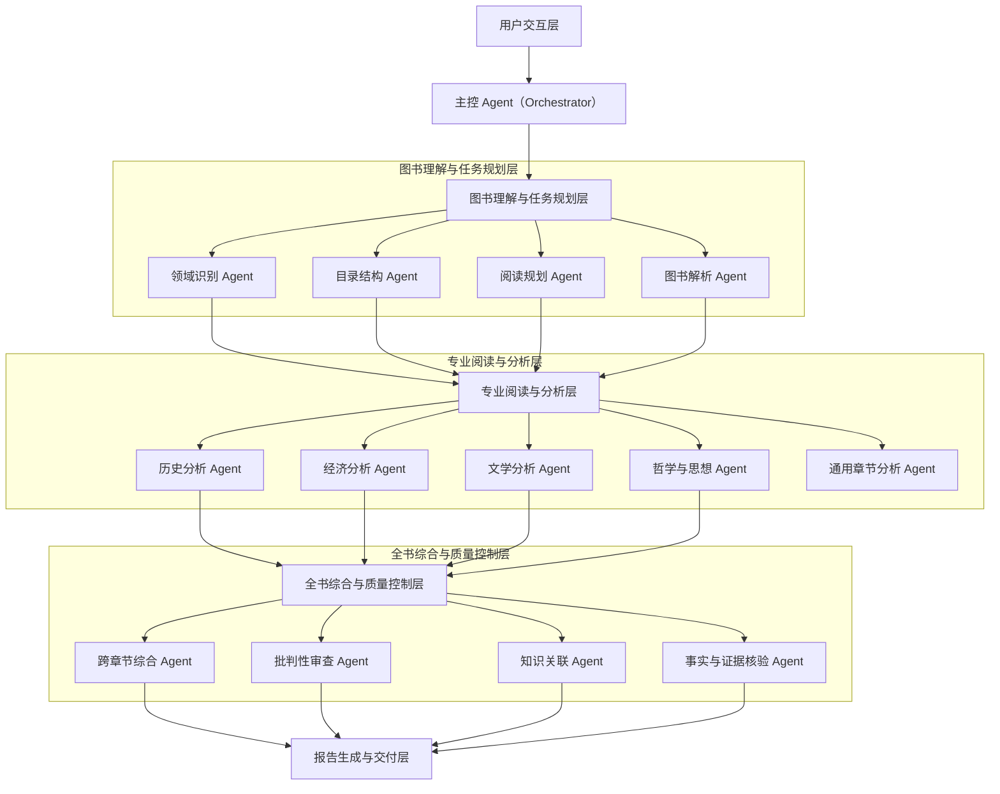

# 项目介绍

一个具备**长文本理解、多领域识别、分层阅读、跨章节推理、知识关联、批判性分析和结构化报告生成能力的多 Agent 知识处理系统**。

一本书可能同时涉及历史、经济、政治、文学、哲学、社会学等多个领域。不同领域的阅读方式并不相同：

	- 历史类图书关注时间线、人物、事件与因果关系；
	- 经济类图书关注理论、模型、数据和论证；
	- 文学类图书关注人物塑造、情节、主题与叙事手法。

因此，系统的核心目标是：像一个具有跨学科知识背景的专业读书团队一样，分工阅读、交叉验证、综合推理，最终生成一份既能帮助读者快速掌握全书，又能支持深入研究的高质量阅读报告。

## 一、明确系统目标与核心需求

### 1. 系统的输入与输出

- 输入层：一本或多本图书

​	PDF、EPUB、TXT、DOCX 等格式；支持电子文本、扫描版 OCR 文本，以及目录、脚注、图表和参考文献等内容。

- 处理层：多 Agent 协同阅读

​	解析图书、识别领域、制定阅读计划、分章节分析、构建知识图谱、跨章节综合推理、事实与引用核验、生成报告。

- 输出层：多层次阅读报告

​	全书摘要、章节精读、领域分析、核心论点、知识体系、人物与事件关系、跨领域洞察、批判性评价、阅读行动指南及原文依据。

### 2. 系统需要解决的关键问题

| 难点                   | 设计目标                                           |
| ---------------------- | -------------------------------------------------- |
| 图书篇幅长             | 分章节、分语义块处理，避免上下文丢失               |
| 涉及多个领域           | 自动识别领域，并动态选择专业分析 Agent             |
| 前后章节存在关联       | 建立全书记忆，识别观点演变、前后呼应和矛盾         |
| 仅总结容易流于表面     | 从论点、论据、方法、因果链和隐含假设等层次提炼     |
| 大模型容易产生幻觉     | 关键结论必须关联原文证据，并区分作者观点与系统推断 |
| 不同图书需要不同读法   | 根据图书类型、阅读目标和实际内容动态调整阅读策略   |
| 报告容易重复、结构混乱 | 统一知识模型、去重、交叉审查和报告质量评估         |

系统不是越多 Agent 越好。合理的方案是以一个总控 Agent 负责规划和调度，以若干专业 Agent 负责执行，再由综合分析与质量审查模块形成闭环。专业 Agent 应按任务需要动态启用，而不是每本书都机械地执行所有流程。

## 二、整体系统架构设计

采用“工作流编排 + 多 Agent 协作 + 共享知识记忆 + 质量评估闭环”的架构。

其中，工作流负责保证流程可控，多 Agent 负责专业化分析，共享记忆负责跨章节关联，质量评估负责防止遗漏、重复和无依据结论。

### 用户交互层

上传图书 · 设置阅读目标 · 选择分析深度 · 选择报告类型

### 主控 Agent（Orchestrator）

任务规划 · 阅读策略制定 · Agent 调度 · 状态跟踪 · 异常恢复

### 图书理解与任务规划层

图书解析 Agent

领域识别 Agent

目录结构 Agent

阅读规划 Agent

### 专业阅读与分析层

历史分析 Agent

时间线、人物、事件、因果

经济分析 Agent

理论、模型、数据、论证

文学分析 Agent

人物、情节、主题、叙事

哲学与思想 Agent

概念、命题、推理、思想谱系

通用章节分析 Agent

负责其他领域，以及专业 Agent 未覆盖的内容

按领域动态启用，允许多个专业 Agent 联合分析同一章节。

### 全书综合与质量控制层

跨章节综合 Agent

知识关联 Agent

批判性审查 Agent

事实与证据核验 Agent

### 报告生成与交付层

结构化报告 · 知识图谱 · 时间线 · 章节导航 · 引文溯源 · 阅读问答

### 贯穿全流程的共享记忆层

原文索引、章节摘要、核心概念库、人物与事件库、论点证据库、跨章节关系、任务状态与版本记录。

这里有一个重要的架构原则：共享记忆不是另一个负责所有工作的 Agent，而是所有 Agent 共同使用的知识与状态基础设施。 每个 Agent 只读取完成任务所需的内容，并将结构化结果写回相应的知识空间。

## 三、Agent 角色设计

建议将系统拆分为四组：前置理解 Agent、专业阅读 Agent、全书综合 Agent、质量控制 Agent。主控 Agent 负责串联这些角色。

### 第一组：前置理解与规划 Agent

1. 图书解析 Agent（Book Parser）

职责： 将原始图书转换为可供模型稳定处理的标准化内容。

- 识别书名、作者、版本、目录、章节、节标题、页码、脚注、参考文献。
- 对扫描版图书识别文字和页面结构，并标记 OCR 低置信度区域。
- 保留段落、表格、图片说明与原文页码之间的对应关系。
- 将长章节拆分为有语义边界的文本块，避免切断重要论证。

输出： 标准化图书文档、章节树、文本块索引、页码映射和解析质量报告。

2. 领域识别 Agent（Domain Classifier）

职责： 判断一本书涉及哪些领域，以及各领域在全书中的重要程度。

- 识别主领域、次领域和交叉领域。
- 判断章节的主要研究对象、分析方法与知识类型。
- 区分作者的核心研究方向与偶然出现的相关话题。
- 对不确定的分类保留多个候选标签，而非强制归入单一领域。

输出： 全书领域画像、章节领域标签、领域置信度、领域之间的关联关系。

例如，一本研究工业革命的书可能同时包含经济史、技术史、社会学和政治史。系统应允许同一章节同时属于多个领域。

3. 目录结构 Agent（Structure Analyst）

职责： 理解作者为什么以这样的顺序组织全书。

- 识别各章节承担的功能：提出问题、铺垫背景、建立理论、提供证据或形成结论。
- 提取章节之间的依赖关系和递进关系。
- 判断作者采用的是时间顺序、主题分类、问题驱动还是论证驱动的结构。
- 找出目录未能充分反映、但正文中实际存在的核心主题。

输出： 全书结构树、章节功能说明、论证主线和章节依赖关系。

4. 阅读规划 Agent（Reading Planner）

职责： 决定整本书应该如何被阅读和分析。

- 根据用户目标确定阅读深度，例如快速了解、系统学习、学术研究或主题提取。
- 综合领域识别和目录结构，选择需要调用的专业 Agent。
- 为每个章节指定分析重点、必答问题和预期输出。
- 识别需要跨章节阅读、联合分析或重点复核的部分。
- 估算任务成本，安排并行处理和必要的串行依赖。

输出： 可执行的阅读计划、章节任务清单、Agent 调度方案和完成标准。

这四个 Agent 的执行顺序不能完全并行。图书解析是基础，领域识别与目录分析可以在解析出足够信息后并行开展，阅读规划则需要综合前面几步的结果。

### 第二组：专业阅读与分析 Agent

专业阅读层采用“通用分析能力 + 领域专用能力”的组合，避免为每个知识细分领域都建立一个独立 Agent。

| Agent                  | 重点分析内容                               | 典型输出                             |
| ---------------------- | ------------------------------------------ | ------------------------------------ |
| 通用章节分析 Agent     | 章节主旨、关键观点、论证过程、重要概念     | 章节摘要、观点清单、证据清单         |
| 历史分析 Agent         | 时间线、人物、事件、制度背景、因果关系     | 历史事件表、人物关系、因果链         |
| 经济分析 Agent         | 经济理论、假设、模型、指标、数据、政策机制 | 理论模型、关键变量、推理链、适用条件 |
| 文学分析 Agent         | 情节、人物弧光、叙事视角、象征、主题       | 人物档案、情节结构、主题与文本依据   |
| 哲学与思想 Agent       | 核心命题、概念定义、逻辑前提、思想流派     | 命题体系、概念关系、论证结构         |
| 社会学与政治分析 Agent | 社会结构、群体关系、权力机制、制度和利益   | 社会关系图、机制分析、群体与制度关系 |
| 科学与技术分析 Agent   | 科学问题、研究方法、实验或论据、技术原理   | 原理说明、研究证据、结论限制         |

这张表不是固定的 Agent 名单。系统应依据实际内容决定启用哪些角色；未列出的领域也可以由通用 Agent 处理，或者通过领域配置动态扩展。

专业 Agent 的设计重点是分析方法不同，而不只是 Prompt 不同。 例如，历史分析需要建立事件的时间与因果关系，经济分析需要显式提取模型假设和变量，文学分析则需要结合文本细节分析叙事与主题。

### 第三组：全书综合 Agent

这是系统能否从“章节摘要集合”提升为“真正理解一本书”的关键。

5. 跨章节综合 Agent

- 将分散在不同章节的观点合并成全书的核心论证主线。
- 识别作者的观点如何形成、发展、修正或发生转折。
- 找出前后呼应、相互补充、相互矛盾以及被后文推翻的观点。
- 判断某个观点是局部结论，还是作者最终坚持的主张。

输出：全书核心论点树、观点演变图、跨章节证据链。

6. 知识关联 Agent

- 建立人物、事件、概念、理论、作品、机构和时间等实体之间的关系。
- 将同一概念的不同称呼合并，并区分含义相近但不等价的概念。
- 识别章节间的隐性联系与跨领域联系。
- 发现知识网络中的核心概念、关键节点和知识缺口。

输出：全书知识图谱、概念关系网络、关键知识路径。

7. 批判性审查 Agent

- 检查作者论证的前提、假设和推理是否充分。
- 识别论据不足、因果关系混淆、样本偏差、以偏概全等潜在问题。
- 区分作者的明确结论、合理推论和存在争议的解释。
- 从其他可能的视角审视作者的结论，避免把作者的主张直接当作客观事实。

输出：论证优点、局限、争议点、待验证问题及审慎评价。

批判性审查需要遵循一个边界：不能仅凭模型认为某个观点可疑，就认定作者存在错误。 报告必须区分文本内可证实的问题、需要外部资料才能验证的事实，以及不同学派之间的合理分歧。

### 第四组：质量控制与报告交付 Agent

8. 事实与证据核验 Agent

对关键结论逐条检查：原文是否真实支持该结论、引用是否准确、页码是否对应、结论是否超出了原文含义。

对无法确认的内容标记为“证据不足”“待核验”或“系统推断”，不得伪造引用。涉及外部历史事实或学术争议时，可以在授权范围内检索可靠外部资料，并将外部证据与书内证据分开管理。

9. 报告生成 Agent

根据用户目标，将已审核的知识产物组织成完整报告。负责统一术语、合并重复观点、控制篇幅、生成目录、引用和图表说明。

它不应自行补写未经审核的新结论；发现内容缺失时，应向综合分析层发起补充任务。

10. 报告质量评估 Agent

从覆盖度、准确性、证据充分性、逻辑一致性、跨章节整合度、可读性等维度审查报告。

对于遗漏重要章节、核心论点缺乏证据、摘要互相矛盾等问题，生成明确的返工任务。达到质量门槛后才交付；未达到时，优先修复问题章节，而不是无差别重读全书。

以上十类角色是逻辑上的职责划分，并不意味着一定要部署十个独立模型实例。实际工程中，部分角色可以共享同一个模型服务，通过不同的任务模板、工具权限和输入输出约束执行。

## 四、核心工作流设计：系统如何真正读完一本书

系统可以拆分为八个阶段。每个阶段都有明确的输入、处理逻辑、输出和质量检查标准，避免多 Agent 只是互相聊天，而没有可追踪的阅读成果。

1. 阶段一：图书接入与完整性检查

   接收图书文件，解析目录和正文，检查乱码、缺页、OCR 质量和文本顺序，建立统一的章节编号与页码映射。

   交付物：标准化图书、章节索引、解析异常清单。

2. 阶段二：全书初读与结构建模

   先通过目录、前言、序言、章节开头与结尾、结论等内容建立全书初步画像，再对正文进行必要的分层扫描。系统此时只形成初步假设，不把目录或摘要当作完整阅读的替代品。

   交付物：全书结构树、初步主题、作者目标、待验证问题。

3. 阶段三：领域识别与阅读任务规划

   识别各章节的领域、主题和分析难度，为章节分配通用分析任务和专业分析任务。对需要结合多个章节才能理解的内容，提前建立关联任务。

   交付物：阅读计划、Agent 任务图、章节验收标准。

4. 阶段四：逐章深度阅读

   以章节为基本单位，在章节内部按语义块处理原文。通用章节 Agent 提取主旨与论证，领域 Agent 深入分析专业内容，并将结果与原文证据绑定。

   交付物：章节摘要、关键观点、专业分析、原文证据和未解决问题。

5. 阶段五：跨章节关联与全书综合

   等主要章节完成后，分析各章之间的论证关系、概念演变、主题重复、观点冲突和因果链条。必要时重新检索原文，进行针对性二次阅读。

   交付物：全书论点树、知识图谱、观点演变图和跨章节洞察。

6. 阶段六：批判性分析与证据核验

   对关键结论进行反向检查：原文是否支持、上下文是否完整、是否存在反例、是否将推测写成事实，以及作者是否在后文修正了先前观点。

   交付物：证据核验结果、争议点、论证局限与待验证事项。

7. 阶段七：报告编排与质量审查

   汇总章节和全书分析，去除重复内容，生成不同层级的摘要和专业分析。质量评估 Agent 按检查清单逐项评分，对问题定向返工。

   交付物：通过审核的报告、质量检查记录和引用清单。

8. 阶段八：交付后的交互式阅读

   用户可以继续提问，例如“作者为什么得出这个结论”“这一观点在哪几章出现”“历史背景和经济机制有什么关系”。系统根据问题检索相关章节、证据和已有分析，必要时触发新一轮分析。

   交付物：带有原文依据的追问回答、补充分析与报告更新版本。

### 关键设计：不要让 Agent 无限制地自由协作

推荐采用有向任务图（DAG）管理依赖关系，并允许有限的动态任务扩展。

例如，第三章涉及工业革命的历史背景与经济机制：

1. 通用章节 Agent 提取章节主旨和关键论点。
2. 历史分析 Agent 提取技术变化、历史事件与制度背景。
3. 经济分析 Agent 提取生产率、资本积累、劳动力变化等机制。
4. 知识关联 Agent 建立历史事件、经济变量与作者论点之间的关系。
5. 跨章节综合 Agent 对照其他章节，判断作者的论证是否前后一致。
6. 证据核验 Agent 返回原文，检查综合结论是否成立。

各专业 Agent 不需要直接反复对话，而是提交结构化分析结果，由主控 Agent 或综合分析 Agent 协调。只有出现冲突、证据不足或存在重要歧义时，才触发额外讨论或复核。

这样既能保留多 Agent 的优势，又能控制延迟、成本和错误传播。

## 五、共享记忆系统：如何避免读到后面忘记前面

长篇图书阅读最重要的技术难点之一，是模型不能把整本书始终放在单次上下文中。因此需要建立分层记忆机制，而不是仅仅把所有章节摘要拼接起来。

建议设计五类记忆。

1. 原文记忆

保存原始文本、章节、页码、文本块 ID、表格和图注等信息。

用途：为每个分析结论提供可回查的原始依据。

2. 章节记忆

保存每章摘要、主要观点、关键概念、重要证据、未解决问题和领域分析结果。

用途：支持后续章节理解、快速回顾和定向重读。

3. 全书语义记忆

保存核心论点、概念定义、人物档案、事件时间线、主题和章节之间的关联。

用途：让系统理解不同章节所讨论的内容之间有什么联系。

4. 证据与争议记忆

保存论点与原文证据的对应关系、相反证据、引用置信度、争议点和审查结论。

用途：防止后续报告只保留支持某个观点的内容，遗漏反例或限制条件。

5. 任务状态记忆

保存每个章节的处理状态、已完成任务、失败原因、结果版本、待执行任务和质量评估结果。

用途：支持断点续读、失败重试、增量更新和任务追踪。

### 记忆如何协同工作？

假设系统读到第八章，作者重新讨论第一章中的某个经济学概念。

此时系统不应只依赖第八章当前的上下文，而应：

- 从全书语义记忆中定位该概念的历史定义。
- 从章节记忆中找到第一章对该概念的初始解释。
- 从原文记忆中检索第一章和第八章的相关段落。
- 比较两次定义是否一致，识别作者是在深化、修正还是推翻原有观点。
- 将新发现写入概念演变记录，并通知全书综合 Agent 更新相关结论。

核心原则是：摘要用于导航，原文用于核验，结构化知识用于关联，任务状态用于恢复。 不能用一份越来越长的摘要取代所有记忆功能。

### 建议采用的知识存储组合

| 存储类型     | 主要用途                                   | 可选技术方向               |
| ------------ | ------------------------------------------ | -------------------------- |
| 关系型数据库 | 图书、章节、任务、状态、报告版本、引用关系 | PostgreSQL                 |
| 全文检索     | 关键词搜索、原文定位、精确引用             | Elasticsearch / OpenSearch |
| 向量检索     | 语义相似度检索、主题召回、跨章节搜索       | pgvector 或专用向量数据库  |
| 图数据库     | 人物、事件、概念、理论及关系查询           | Neo4j                      |
| 对象存储     | 原始 PDF、图片、OCR 结果及生成文件         | S3 兼容对象存储            |

这些组件并非第一版全部必需。可以先采用关系型数据库、全文检索和向量检索构建最小可用系统，等跨章节关系分析确实需要图遍历时，再引入独立图数据库。

另外，向量相似度并不等于事实成立。对引用、数字、人物关系和具体事件，应优先使用原文定位、关键词匹配与结构化关系核验，再将语义检索作为补充。

## 六、最终报告应该输出什么

系统最终交付的不应该只有一份几千字的读书摘要，而应是一套可分层阅读、可追溯证据、可继续探索的知识成果。

我建议把报告分为三个层级：快速掌握、系统理解、深度研究。用户既可以一次性生成完整报告，也可以按需查看具体模块。

### 第一部分：图书概览与全书核心思想

## 《图书名称》深度阅读报告

示例报告结构 · 实际内容由图书分析结果生成

### 1. 图书基本信息

- 书名、作者、版本、出版信息

- 主要领域、相关领域与适用读者

- 全书篇幅、章节结构及阅读范围

  ### 2. 一句话理解全书

  用一句话说明作者真正想解决的问题，以及全书最核心的思想。

  ### 3. 全书核心摘要

  用约 500–1000 字概括研究背景、核心论点、主要论证、最终结论和重要价值。

  ### 4. 必读内容与关键结论

- 最值得记住的 5–10 个观点

- 每个观点对应的章节和原文依据

- 观点成立的条件与适用范围

  ### 5. 全书结构与阅读路线

  说明章节如何衔接、论证如何推进，以及哪些章节最值得精读。

这一部分的目标是让读者在较短时间内建立全书认知框架，但不把摘要当作完整阅读的替代品。

### 第二部分：逐章节深度分析

每章采用统一的基础结构，再根据所属领域增加专属分析模块。

| 分析模块   | 具体内容                                   |
| ---------- | ------------------------------------------ |
| 章节定位   | 本章解决什么问题，在全书中承担什么作用     |
| 核心摘要   | 本章主要内容和结论                         |
| 核心观点   | 作者提出了什么主张，观点之间有什么逻辑关系 |
| 论证与证据 | 使用了什么案例、数据、史料、文本或理论     |
| 关键概念   | 概念定义、概念间的联系及其变化             |
| 深度解读   | 隐含前提、关键机制、未明说的推论           |
| 局限与争议 | 证据不足、适用条件、可能的替代解释         |
| 原文索引   | 页码、章节、段落位置及相关引文             |

在此基础上，专业领域可以动态增加不同的分析模块：

- 历史类： 历史背景、人物经历、事件时间线、直接与间接原因、制度变迁。
- 经济类： 理论模型、变量关系、关键假设、数据证据、政策机制及适用边界。
- 文学类： 人物关系、情节发展、叙事视角、主题、象征意象与文本细读。
- 哲学类： 核心命题、概念定义、推理前提、论证过程、反例与思想流派。
- 社会学类： 社会结构、群体关系、制度影响、权力机制及解释框架。

### 第三部分：全书知识体系与跨章节分析

这是整个产品区别于普通阅读总结工具的核心价值所在。

1. 全书知识图谱

将人物、事件、概念、理论、作品与制度组织成关联网络，展示重要实体的关系、关联章节和对应证据。

2. 时间线与发展脉络

适用于历史、传记、经济发展史和思想史。区分事件发生时间、作者叙述顺序以及观点发展的时间顺序。

3. 核心论点树

从全书总论点向下拆解为子论点、论据和结论，标明每个节点由哪些章节支持，以及是否存在反例。

4. 跨领域洞察

找出不同学科对同一问题的解释方式、共同机制和冲突。例如，一本工业革命史可以从技术创新、资本积累、制度变化和社会结构多个角度综合分析。

跨领域分析尤其需要谨慎：不同领域的概念即使名称相似，也未必含义相同。系统应先确认概念定义和适用范围，再建立联系，而不是为了生成“新颖观点”强行拼接知识。

### 第四部分：批判性阅读与作者观点评价

建议把作者的观点与系统的分析明确分开。

| 评价维度   | 输出内容                                         |
| ---------- | ------------------------------------------------ |
| 论证完整性 | 核心结论是否有充分论据支撑                       |
| 逻辑一致性 | 前后章节是否存在矛盾或未经解释的转变             |
| 证据可靠性 | 原文使用的史料、数据、案例或研究是否足以支撑结论 |
| 隐含假设   | 作者默认了哪些条件，这些条件是否合理             |
| 反向论证   | 是否存在合理反例或替代解释                       |
| 适用边界   | 哪些条件下观点可能不再成立                       |
| 进一步研究 | 哪些问题值得查阅其他资料或开展深入研究           |

这里必须区分三种结论：原文明确陈述、根据原文得出的合理推论、需要外部证据验证的判断。这样才能防止系统把模型自己的解释包装成作者原意。

### 第五部分：知识内化与行动指南

如果读者的目的不仅是了解一本书，还希望真正掌握知识，可以增加以下模块：

- 核心知识卡片： 概念、定义、原文依据、示例和相关知识。
- 复习问题： 从基础理解到综合推理，检验是否真正理解全书。
- 知识迁移： 讨论书中思想在其他场景中的可能应用，同时注明适用条件。
- 阅读后续路线： 推荐值得进一步研究的问题、相关理论和待阅读主题。
- 个人学习计划： 根据用户设定的目标生成复习和深入学习安排。

这些模块应由阅读目标决定是否启用，而不是每本书都强制生成。

## 七、系统如何保证报告质量

对于这种长文本、多领域的 Agent 系统，不能仅依赖最终模型的主观判断。建议建立可量化的评估体系。

| 指标             | 评估方法                                       |
| ---------------- | ---------------------------------------------- |
| 内容覆盖率       | 检查重要章节、核心主题和主要论点是否遗漏       |
| 证据支持率       | 抽查关键结论，验证原文是否确实支持结论         |
| 引用准确率       | 检查引文、页码、章节和上下文是否对应           |
| 跨章节关联准确性 | 人工审核观点关联、时间线、实体关系及概念演变   |
| 领域分析质量     | 由相应领域评审标准检查专业分析是否正确         |
| 重复率           | 检查报告中是否反复出现相同观点                 |
| 逻辑一致性       | 检查章节摘要、全书结论和批判性评价是否相互矛盾 |
| 用户满意度       | 评估可读性、实用性、深入程度以及追问解决效果   |

可以把它们作为初期评估的主要维度，但不应在没有测试集和人工评审的情况下，直接设定看似精确的达标数据。

### 质量审查的闭环

生成章节分析与全书结论

核验证据、覆盖度和逻辑一致性

是否通过质量门槛？

通过

进入报告生成

未通过

定向重读、补充证据或修正分析

设置最大重试次数；无法解决的问题保留为未确认事项，不无限循环。

为了让评估结果真正可信，建议选取一批具有代表性的图书建立人工标注基准，包含不同领域、不同篇幅、不同文本质量以及跨领域作品。通过对比人工阅读结果与系统输出，逐步优化 Agent 的任务划分、分析模板、检索策略和质量门槛。

## 八、技术选型建议（暂不涉及代码）

| 技术模块   | 建议方向                                   | 主要作用                               |
| ---------- | ------------------------------------------ | -------------------------------------- |
| Agent 编排 | LangGraph 或自研工作流引擎                 | 管理任务依赖、状态、重试和人工介入     |
| 大语言模型 | 支持长文本分析、结构化输出和工具调用的模型 | 执行章节理解、专业分析和综合推理       |
| 文档解析   | PyMuPDF、Unstructured、OCR 工具链          | 处理电子书、扫描件、目录和复杂文档结构 |
| 文本检索   | Elasticsearch / OpenSearch                 | 精确定位关键词、章节及引用             |
| 向量检索   | pgvector 或专用向量数据库                  | 支持语义检索与跨章节关联               |
| 结构化存储 | PostgreSQL                                 | 管理图书、任务、知识条目、报告和版本   |
| 知识图谱   | Neo4j 或关系型图表结构                     | 保存人物、事件、概念和论点之间的关系   |
| 任务队列   | Celery + Redis，或 Kafka 等消息系统        | 调度长耗时任务、并行处理和失败重试     |
| 评估体系   | 固定测试集 + 自动评估 + 人工审核           | 检查准确性、覆盖度和稳定性             |
| 报告生成   | Markdown / HTML 渲染及 PDF、DOCX 导出      | 交付阅读报告和可追溯的知识成果         |

这些是可选技术方向，并不要求一次性全部引入。具体选择需要结合图书规模、并发量、部署环境、预算、模型资源以及数据安全要求。

## 九、从 FDE 角度，建议如何分阶段落地

我不建议第一版就建设完整的十类 Agent、知识图谱和复杂反思机制。应该优先验证最重要的用户价值：系统能否真正理解一本长篇、多领域的书，并输出可信、完整且有深度的报告。

## V1

基础阅读与结构化报告

实现图书解析、章节切分、通用章节分析、基础领域识别、共享记忆和报告生成。

验收重点：长文本不丢章节，摘要有原文依据，能够形成完整的章节级和全书级报告。

## V2

多领域专业阅读

增加历史、经济、文学、哲学等专业分析 Agent，支持动态调度、章节间关联和定向二次阅读。

验收重点：专业分析确实比通用摘要深入，并能正确处理跨领域章节。

## V3

全书推理与知识图谱

增加跨章节综合、概念演变、人物和事件关系、知识图谱以及批判性阅读能力。

验收重点：能够发现章节间的隐含关系、观点冲突和知识体系，而非简单拼接摘要。

## V4

可信阅读与持续学习

完善证据核验、质量闭环、断点续读、交互式问答、学习卡片和个性化阅读路线。

验收重点：结果可追溯、失败可恢复、报告可迭代，用户能持续围绕一本书深入探索。

## 十、最终的产品定位

我建议将这个项目定义为：

多领域智能阅读与知识提炼平台（Multi-domain Intelligent Reading & Knowledge Synthesis Platform）。

它与普通 AI 读书工具的区别，不在于使用了多少个 Agent，而在于是否形成了以下能力闭环：

1. 理解全书： 从目录、章节到整体论证建立完整结构。
2. 专业阅读： 根据历史、经济、文学等不同领域选择适合的分析方法。
3. 建立联系： 把分散在不同章节的观点、人物、事件和概念组织起来。
4. 验证结论： 将重要判断绑定原文证据，并区分作者观点与系统推断。
5. 形成知识： 输出结构化报告、知识图谱、阅读路线和可复用的知识卡片。
6. 持续深化： 支持用户追问，并能够根据问题重新检索、分析和更新结论。

从架构上看，最关键的三个设计决策是：以主控 Agent 和可控工作流负责执行，以共享记忆负责全书上下文，以证据链和质量评估负责可信度。

这三个基础打牢之后，再逐步增加专业 Agent、知识图谱和更复杂的推理能力，才能把系统从“自动生成读书摘要”真正发展为“能够协助用户理解、分析和掌握一本书”的智能阅读系统。